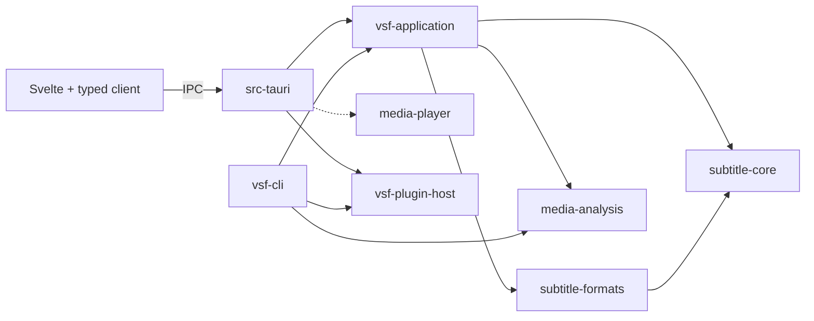

# Architecture

VisualSubForge is a desktop subtitle editor built with Rust, Svelte, TypeScript
and Tauri. This is the authoritative overview of the implemented architecture.
[Current status](docs/status.md) records implemented scope and release limits.
PR descriptions record validation results; the [test guide](tests/desktop/README.md)
describes reproducible commands and their scope.

The design keeps accepted subtitle state in Rust, transient interaction state in
Svelte, and native playback behind a narrow boundary. Desktop and CLI callers
share application operations without requiring a running GUI. Native playback
remains experimental; its implementation does not establish platform acceptance.

The three platform package workflows own assembly, source capture and native
checks. The release workflow calls them for one commit, verifies their checksum
manifests and stages the public downloads. The Mac package workflow owns signing
on main. Windows version resources identify the GUI, CLI/plugin runner and
installer as VSF. FFmpeg and ffprobe retain their upstream identity. Linux natively builds its private media SDKs on Ubuntu 22.04 for each architecture.
One payload supplies both the portable archive and the Debian package. The assembler
maps every direct system SONAME in the architecture’s ELF receipt to its distribution
package. This mapping generates the launcher’s checks, its install command and the
Debian dependencies. The assembler copies private
media libraries with per-file origin-relative runpaths. GTK, WebKitGTK and
driver libraries retain their distribution-managed dependencies. The loader
audit observes bindings and mapped files in the running GUI process.

The GTK timer services libmpv render updates on the GTK main thread. It tracks a
pending frame until GTK paints it or the surface becomes unmapped, at which point
it acknowledges a skipped frame. GTK can discard a queued draw during
close/reopen or occlusion. The mpv control worker remains independent of painting.

## Desktop update checks

The first application network request is an optional Rust-owned query to the
public GitHub releases API. Startup reads preferences locally. A non-modal
footer asks for consent, and the display owner schedules a delayed check only
after automatic checks have been enabled. Help can request a check explicitly.
The webview uses the typed client and its existing CSP. The notice occupies a
layout row outside the native video surface.

The desktop service reads and atomically writes consent through the preferences
writer. Settings and the startup notice use the same consent command. General
preference saves preserve stored consent and layout under the writer lock. A separate bounded `update-check-v1.json` records attempts and the last
dismissed version. An OS file lock shared across app processes reserves the 24-hour interval before the
request, including failed attempts. Disk operations use blocking workers. A
manual request cancels a previous request. The exit gate cancels in-flight work,
and the display owner discards obsolete replies. No lock spans network IO.
Rust fetches at most 1 MiB over HTTPS, rejects redirects, compares semver
precedence, and constructs the browser destination from its fixed repository
and a parsed version. The app never installs a release.

## Code map and dependencies

Arrows show the main call/dependency paths. The dashed arrow is optional native
playback, enabled by `media-prototype` (also enabled by `macos-angle`). The desktop
also calls the domain, formats and analysis crates directly; build/test dependencies
and external libraries are omitted. The table explains each boundary.

| Location | Responsibility and dependency boundary |
| --- | --- |
| `crates/subtitle-core` | Cue identities, millisecond times, document invariants, edits and undo/redo. No external crate, filesystem, UI or media dependency. |
| `crates/subtitle-formats` | SRT, ASS/SSA and WebVTT parsing, source preservation and serialization. Depends only on the domain; performs no filesystem IO. |
| `crates/vsf-application` | Shared checking, repair proposals, authoring, conversion, translation, resynchronization and file policies. Uses domain/formats and `media-analysis`; has no Tauri or native playback dependency. |
| `crates/vsf-cli` | Arguments, signals, reports and exit codes for headless operations. Composes application operations with the plugin host when needed. |
| `src-tauri` | Desktop startup, typed command adapters, accepted document/project owners, background services and native window integration. |
| `src/lib` and `src/App.svelte` | Components, transient session owners, typed client and pure timeline/selection calculations. |
| `crates/media-analysis` | Bounded FFmpeg/ffprobe subprocesses for probing, waveforms, scenes and alignment. Independent of subtitle state and Tauri. |
| `crates/media-player` | Native player/graphics adapters and audited Rust FFI. Independent of subtitle domain types. |
| `crates/plugin-host` | Package name `vsf-plugin-host`: JavaScript engine and bounded helper-process transport. Production dependencies exclude the application and domain. |

The desktop and CLI call `vsf-application` directly. The application plugin API
accepts an injected executor; it does not depend on the JavaScript engine crate.
Optional schema derives support desktop bindings without pulling Tauri into
shared operations. Actual build dependencies are declared in each `Cargo.toml`.

These boundaries are partly logical. Desktop document-session coordination still
lives in `src-tauri/src/document.rs` and its submodules, alongside IPC projections.
`App.svelte` is the workspace composition root: it constructs sessions, wires
callbacks and delegates its short action switch to subtitle/project-file, media,
cue-editing and view/panel action functions. `Workspace` owns task activity and messages and
derives shared gates from modal, decision and gesture activity.
Cue-table, cue-editor, waveform and shell markup live in components receiving the
relevant owners. WorkspaceToolbar, RecoveryCard, WorkspaceFooter,
PlaybackDiagnostics and FontDiagnostics retain scoped styles; WorkspaceDialogs
renders feature content from the modal identity. TransportBar, CueOperationsBar, SubtitleToolbar and VideoPreview own their region
markup and scoped styles. WorkspaceDecisions and WorkspaceLegacyImport render
decision-owned payloads; ActionBrowser presents command discovery and searchable keyboard help. App creates owners and
lays out regions. With no accepted document or loaded media, StartScreen replaces
workspace presentation while the region owners remain mounted and inert. The
zero-size video placeholder retains the window backdrop. New subtitles uses the
existing accepted Create operation (an untitled SRT with its first empty cue).
RecoveryCard reuses Recovery; loaded work reaches it through a HideVideo modal.

WorkspaceOpen owns picker/drop admission and a disposable native drop listener.
Classification rejects ambiguous groups before mutation. A video/subtitle pair
opens subtitles first so cancellation of unsaved-work protection stops the pair;
these are sequential operations, not a cross-file transaction. Subtitle/media
paths reuse the picker continuations, projects use guarded ProjectWorkflow.openPath,
and legacy paths preselect the existing explicit import review. Late picker and
listener replies cannot reopen work after disposal. client.ts owns the native
subscription boundary.

App dates use the UI language for words and the OS formatting region for date order and hour cycle, with a fixed English day–month–year, 24-hour fallback.

RecentWork keeps a bounded historical projection, not another document/checker
owner. Rust captures version-checked paths and completed checker metadata from
existing media/scene/document/project owners, releases those locks, then hashes
saved bytes and atomically updates a separate recent-work-v1.json file. Its own
writer mutex serializes only metadata IO; the list is capped at 12 entries and
128 KiB. New dirty, recovered, resynced or unmatched checks supply no counts. A missing
summary retains historical counts only when the saved subtitle bytes still match
their recorded hash. Capture identity tracks open/save/completed clean checks,
not each dirty edit. Close-only transitions suppress capture, including late checker
completion; opening or saving permits it again. Reopening media alone revisits
its most recent recorded subtitle pairing instead of adding a media-only entry.
Recorded source/profile hashes, completion coverage and check time describe the
saved content at capture, not a fresh check of today's disk bytes. Reading the
list never opens old documents or starts checking. Frontend capture is debounced
and serialized, suppresses obsolete replies and does not retry failed mutations.
Removal waits for pending capture and changes only metadata. Recent opens enter
the same protected workspace operations as picker/drop actions.
Action labels, aliases and shortcut descriptions live in
`workspace/action-descriptions.json`, imported by the frontend and embedded by
Rust's native menu builder. Version-6 preferences hold validated bindings by
focus mode; bundled presets share one JSON source across Rust and TypeScript.
The pure workspace router resolves those bindings while retaining composition,
repeat, text-history and Windows fallback rules. `WorkspaceCommands` derives discovery eligibility and delegates commands
to existing owners after modal close; it owns no accepted state or background
work. Cue jumps recheck the captured document before entering ordinary protected
selection. Native menus use registry groups/order and the same eligibility and checked-state
projection as discovery. Nested Layout, Theme and Density items participate in
recursive accelerator publication. Theme/density commands borrow a temporary
SettingsSession and dispose it after one confirmed save; failures are reported
without replaying writes.

The command palette, Commands menu and shortcut sheet use `WorkspaceModal` and
`HideVideo` for hide-before-presentation, close ordering and return focus.
`Tooltips` owns one delayed tooltip and delegates the same native-video lifetime
to `HideVideo`; cancellation/disposal retires its timer and pending presentation.
Modal/menu admission retires hover presentation first, and active workspace
operations/modals/menus block new tooltips. Other overlays include active tooltips when restoring remaining occlusion, and
tooltips preserve active modal/menu/diagnostic occlusion. Tooltip presentation
never changes a document or admits an operation.

Appearance comes from `src/lib/ui/`: `tokens.css` defines the dark and light
palettes, type and shape, and `base.css` styles native elements. Components use
tokens in their scoped styles instead of color literals. The waveform canvas reads
tokens through `canvas-palette.ts` and redraws when the theme or loaded fonts
change. `Appearance` projects confirmed theme/density preferences onto root attributes,
with one system color-scheme listener per mounted workspace and disposal cleanup.
Settings retains draft/save/Undo ownership; failed saves do not change effective
appearance. Global control padding tokens do not change per-preset cue-row density.
Modal close acknowledges native bounds after any density-driven geometry changes.

WindowChrome owns native window presentation only. macOS uses an overlay title
bar with reserved traffic-light space; Windows keeps native captions and OS snap
behavior. Windows/Linux expose registry-backed top-bar menu groups through the
existing HideVideo modal. Linux reads its confirmed custom-caption opt-in once
per mount, so changing it requires restart. Decoration/maximize operations hide
video, acknowledge rendered bounds, then restore remaining occlusion. Unknown
decoration outcomes reconcile through a read without replaying the write and
retain caption controls if that read fails. Close enters the protected workspace
Quit operation. All native window calls pass through client.ts with main-window
capabilities; disposal suppresses later presentation. Drag and physical snap
behavior remain platform acceptance work, not browser-test conclusions.
The page body stays transparent so the native video surface can show
through; the visible window color is painted by the video placeholder.
CueNavigation coordinates selection, following, reveal and focus through narrow
DOM callbacks. WorkspaceStartup loads initial state, WorkspaceMenus owns the native
menu subscription, and NativeVideoLayout owns native layout tracking;
WorkspaceView owns only panel toggles and their open/close rules. WorkspacePreferences
owns saved defaults, effective timing and quality invalidation; WorkspaceScenes owns
scene controls and projections. MediaSession owns the chosen path/hardware policy,
and TimelineView owns playback following and waveform interaction state.

## Start reading the code

Follow the cue-edit walkthrough below, then read these entry points in order:

1. [main.rs](src-tauri/src/main.rs): constructs desktop owners and wires startup/exit.
2. [document.rs](src-tauri/src/document.rs): follow `document_action` into
   `Documents::apply` and `Store::apply` to see version checks and accepted state.
3. [editor.rs](crates/subtitle-core/src/editor.rs): follow `apply_edit` and history
   publication; [source.rs](crates/subtitle-formats/src/source.rs) supplies format policy.
4. [DocumentSession](src/lib/document/document-session.svelte.ts): follow draft submission
   and accepted-reply reconciliation through the [typed client](src/lib/client.ts).

## Accepted state and transactions

`Documents` owns a mutex-protected `Store`. Its loaded document contains one
`Editor<Source>`, the source path and saved-byte baseline, save-protection flags,
and translation context. The store also coordinates quality policy and feature
jobs. The frontend and analysis workers do not own the live accepted editor.

`Editor<Source>` owns cues, immutable format properties, revision and undo/redo
history. Cue IDs remain stable independently of table position. History records
the replaced cue span and, when changed, document properties. It does not take a
whole-document snapshot for every single-cue edit. Saved-state identity is
separate from revision, so Undo can return to saved content while revisions keep
advancing. A coalesced text group that returns to its original content removes
its empty history entry and restores its prior state identity; it also ends the
group so later typing cannot merge into earlier history. Format properties participate in the same transaction as cue edits.

A document generation identifies replacement/open/recovery; a revision identifies
accepted edits within that generation. Document-edit requests carry both. Rust checks
them before committing and validates candidate output against format and size
policy. Rejected edits preserve accepted content, history and saved state.
Read-only checks can report quality problems without preventing legitimate edits.

The document mutex is the transaction boundary for accepted state and related
context. Moving code between modules must preserve that boundary. Splitting
locks or introducing another mutable owner requires a separate concurrency design.

## Error boundaries

`subtitle-core::Error` names domain failures and retains revision, cue identity
and time-range context. Editor validators return application-owned messages;
the editor wraps rejection in `ValidationRejected` without interpreting format,
size or IO policy. Validation still precedes history/identity publication, and
rejection preserves the existing editor, redo, revision and saved-state identity.

`subtitle-formats::Error` covers format dispatch, extension validation and SRT
parsing/serialization, including nested line and domain context. ASS/SSA and
WebVTT internal APIs still return their detailed messages; dispatch distinguishes
parse from validation failures and attaches the format. Application policies
retain their existing report errors. Text adapters use the errors' `Display`
implementation at those boundaries, preserving CLI reports and other command
messages. The document IPC command returns a generated tagged error: stale revision,
replaced document, rejected operation or unknown outcome (`outcomeUnknown`). Version checks occur
under the existing document mutex before mutation; the client preserves the tag
and message in `DocumentFailure`. Unknown transport/worker outcomes are distinct
from confirmed rejection. Error types add no worker, lock or document owner.

## Frontend ownership and reconciliation

| Owner | State it owns |
| --- | --- |
| `Workspace` | Workspace task counter, readiness, error and notice; derives busy and confirming from owner activity and exposes the shared admission check. |
| `WorkspaceActivity` | Counts overlapping user-awaited tasks, changed-input timing admissions and the first quality read for changed report inputs. Cue selection registers through the workspace task. The permanent footer slot appears after 150 ms and stays visible for at least 300 ms. Its spinner is decorative. The primary footer status reads Working… while visible and resumes the current message afterward. Background polling runs independently. |
| `DocumentSession` | Replacement-only accepted projection, selection and text/time/style drafts; serialization and reconciliation of document commands. |
| `CueEditing` | Pause/blur/IME/Escape triggers, focus identity and cancellable auto-commit timer. It owns no accepted history. |
| `CueFixes` | Debounced selected-cue repair admission, bounded polling and stale/disposal guards; the existing Rust timing worker owns the plan. |
| `TimingGesture` | Held-Space timing, boundary preview/captured version, magnetic targets and range/loop restoration. It exposes activity; Workspace derives the gate and owns messages. |
| `CueTableView` | Filtered file-indexed rows, fixed-density virtualization, column projection and active cue IDs. App supplies accepted cues/playback reads; CueTable owns its DOM observer and cleanup. |
| `TimelineView` | Waveform viewport, selection range and live-loop preview updates, visible cues, duration, analysis start/polling and stale-reply rejection. App supplies playback and gesture state. |
| `MediaSession` | Playback projection, polling and response ordering, plus serialized/coalesced live-loop requests. |
| `ProjectWorkflow` | Project attachment projection and ordered open/save/quit continuations. Rust owns the persisted identity. |
| Feature sessions | Dialog inputs, bounded review projections, request identities and cancellation/disposal. Rust owns proposals and acceptance. |
| `WorkspaceDecision` | Unsaved-work, project-save-failure, project-reference and legacy-import hide/wait/answer lifetimes. Decisions own typed display payloads; LegacyImportDecision also owns return focus. App supplies media callbacks; Workspace derives confirming; save/exit policy stays in UnsavedChanges and ProjectWorkflow. |
| `HideVideo` | Shared hide-before-show, render-before-restore, remaining-occlusion, epoch and disposal lifecycle for modals, decisions and the cue menu. |
| `CueMenu` | Captured cue/range context, menu replacement, command activity and menu focus lifetime. |
| `Recovery` | Recovery listing, polling/response epochs, discard confirmation and recovery action activity. |
| `WorkspaceDialogsState` | Dialog eligibility, inputs and post-close continuations over WorkspaceModal identity; accepted content remains with DocumentSession. |
| `WorkspaceModal` | Modal identity/transitions, native-video hide/restore ordering and return focus for command discovery/keyboard help, styles/fonts/conversion/plugins, timing reviews, Settings, resync, statistics and text tools. |
| `CueNavigation` | Selection/focus/reveal orchestration, dock cue links and cue-following effects; uses workspace tasks without assigning the gate. |
| `TimingReviewSelection` | Review-scoped checkbox toggles, disclosures, proposal/manual page positions and the scroll anchor keyed by row identity. WorkspaceView holds the selection while tabs change. |
| `WorkspaceView` / `WorkspaceLayout` | Panel visibility/rules and measured pane sizes/splitter constraints, respectively. |
| `WorkspacePreferences` | Saved defaults, effective project timing, metric visibility and quality-context invalidation, updated through initialization, acceptance and restore methods. |
| `WorkspaceScenes` | Scene visibility, cuts, controls, status and restored-generation projection. |
| `UnsavedChanges` | Subtitle save and the unsaved-changes guard; each caller supplies its project-save continuation. |
| `TranslationReference` | Protected reference attach/copy/offset/detach actions and lifetime guards. |
| `WorkspaceStartup` / `WorkspaceMenus` | Initial state loading and native menu projection/subscription, respectively; each guards late replies after disposal. |
| `NativeVideoLayout` | Coalesced native layout requests, resize observer, window listeners and polling timer; disposal removes all subscriptions and suppresses late replies. |
| `App.svelte` | Owner construction, narrow DOM callbacks, short action dispatch and screen regions. |

Decision payloads are published only after native video hides and are cleared before
restoring remaining occlusion and settling the answer. LegacyImportDecision keeps
publication/open continuation and return focus together; no external open-flag shim
is needed. UnsavedChanges does not depend on ProjectWorkflow: callers explicitly
supply the appropriate save continuation, including the project operation's own
save context. TranslationSession clears hidden reference queries in its initialization
scoped effect; TranslationReference handles user file operations and quality invalidation.

In Issues and Timing, the primary cue button extends over its row. Checkboxes,
disclosures, related cues and repair actions have independent hit targets and
keyboard focus. Timing disclosure updates the review’s expanded rows.
Following a cue keeps the originating dock tab. ReviewDock defers focus transfer
on a dirty cue link until the click has captured its target. Dock links and F4
delegate to CueNavigation.selectCue, the same apply-before-selection workspace
task used by list rows. A rejected commit leaves the selection, draft and inline
reason in the editor. After success the dock focuses the invoking button, or its
replacement when the refreshed report arrives. Further input or closing the
dock cancels focus restoration. Translation can temporarily hide the dock. Preference initialization,
Settings acceptance and project timing restoration each update the related fields
through one owner method; project timing never replaces saved defaults.

WorkspaceModal, WorkspaceDecision and CueMenu delegate native-video transitions
to HideVideo. Modal admission failures are reported and modal close restores focus;
decision admission failures propagate and decisions settle their answer after close.
A table context menu commits the pending draft, retargets an outside click, and
captures cue IDs, document generation, revision and media session. Waveform
targets retain their cue or time range. For a group, CueMenu requests availability
after committing the draft and checks that the captured revision still holds
before presenting the menu. Rust trials all three edits on private copies of the
accepted document, outside the store lock, using full document order and the
same format and serialization checks as a commit. A failed query leaves the
menu closed. The native dialogue command reads the same availability for a
two-cue selection and discards late replies. Both routes dispatch the same
revision-checked edit. The application validates each pair and
constructs format-specific text. The core replaces the run with one cue spanning
its earliest start to latest end, or deletes the selected IDs while retaining
intervening cues. Each operation records a single undoable range replacement.

For a single cue, Rust rounds the midpoint on the source time grid and trials the
existing split through the same serializer. The private trial preserves the next
cue ID, including after deletions, because source labels can depend on identity.
CueEditing shares one midpoint read
between both menus and dispatch, keyed by generation, revision and cue ID.
After a draft commits, dispatch reads the new version. It submits the returned
time with the version Rust checked. A refusal supplies the disabled menu reason.

The menu permits replacement while visible and retains its immediate return-focus
policy. The shared lifecycle waits for native-video hiding before exposing content.
Closing removes content, waits for rendering, restores the remaining diagnostics
occlusion, then releases the workspace gate before restoring focus. A close during
opening waits for that hide reply; disposal invalidates continuations and leaves
native cleanup to media teardown. Workspace derives its overlapping authoring gates from
this owner and supplies DOM/media callbacks and feature eligibility. Dialogs/sessions
still protect pending acceptance and own their drafts; project-save and unsaved-work
continuations retain their separate owners. Overlapping feature visibility derives from the modal identity.
The docked Review panel keeps Issues, timing repairs, Shift and Statistics beside
the cue list; it does not use HideVideo. WorkspaceView owns its tab/purpose and
transient acceptance busy state. Acceptance gates competing workspace actions;
read-only previews do not. Statistics verifies its captured document/media/quality/scene
version before protected navigation; text navigation rechecks document identity and drafts
before selecting a cue and restoring its UTF-16 selection. Settings persistence
epochs and picker guards remain in the dialog. Legacy import and project decisions
share WorkspaceDecision presentation; publication and save/exit continuations
remain separate. CueMenu retains its captured context and focus lifetime over the shared HideVideo lifecycle.

CueNavigation applies drafts before explicit selection, preserves captured-document
checks and keeps automatic following separate from seek-producing selection. DOM
access is limited to viewport reads, scrolling and focus callbacks. Its operations use Workspace.task; accepted state and undo remain in Rust. Effect-bearing
owners are constructed during component initialization.
Named cue-editing, workspace-quality and workspace-menus modules derive the current
projections; UnsavedChanges and project-view retain save/restore policy and sequencing.

Stateful and lifetime-bearing owners are classes; stateless actions and derivations
are functions. App constructs dependencies first, explicitly connects the remaining
callback graph before mount, and registers each disposal beside construction through
`disposeWithComponent`. Cleanup guards are invalidated synchronously; media stops
its live loop before gesture/timeline teardown, and decision promise continuations
run after every owner is disposed. CueTable owns its list observer. NativeVideoLayout
owns and removes its resize observer, window listeners and 100 ms timer, coalesces
in-flight requests and suppresses late replies. Workspace.task counts nested and
overlapping operations, so an inner completion cannot release the outer busy gate.

Session objects live for a component/workspace mount and are disposed explicitly.
Accepted snapshots use replacement-only `$state.raw`; components do not mutate
accepted cue objects. Drafts and gesture previews remain separate. A gesture
commits the document version captured when it began, not a newer version that
happened to arrive before release.

Async owners check request epochs and captured document/media/context identity
before publishing replies. Closing during a pending start also cancels the job
when its ID eventually arrives. Disposal suppresses late UI updates and follow-up
commands; it cannot undo a mutation already accepted by Rust. Acceptance flows
that reconcile a lost reply fetch authoritative state before continuing.

Fix and Shift share `TimingRepairSession` for
start/read/page/cancel/accept ordering and disposal. Fix schedules changed live inputs immediately and silently retires
superseded reads. Shift starts the initial preview on open and debounces subsequent inputs for 250 ms. Both compare semantic keys
so unrelated playback updates cannot starve admission. Fix retains a display-only
page and viewport projection across revisions within a document generation, media
session and review context. The shared settle timer controls their updating style.
Only the current capture and Rust proposal can admit Apply. The retained timing review retries a start only when Rust reports a busy worker or changed timing policy
through the generated IPC error kind. Other refusals display their message immediately.
Read-only admission retries stop after three attempts; mutations
are never retried. The capture is reactive and accepted snapshots remain immutable.
Switching away from Timing disposes its worker. On return, the semantic key
(document generation/revision, media session, scope IDs, quality/scene context,
families and options) determines which review choices the new session receives.
Closing the dock clears those choices. Read-only Timing and Statistics captures
can remain live during a review navigation seek. Apply uses workspace admission
throughout the seek. Coverage eligibility stays in the session adapter. Fix permits no-media
acceptance, with an explicit note beside Apply; missing attached-media scene
coverage remains protected. Completed plans poll for Rust-owned invalidation.

Rust's `quality::timing_selection` prepares the selected subset on the existing
worker, checks repaired candidates against the whole document and captured
profile/scene context, and refuses unsafe coupled subsets. Explicit shifts retain
their documented overlap semantics. Acceptance revalidates the immutable capture
and applies one history operation. Full plans stay in Rust: review pages contain
100 rows; an independent projection requests at most 200 visible cue IDs for
frontend dashed ghosts and list deltas. Those projections cannot mutate accepted
state, and disappear on context changes, closure or disposal. Statistics retains
its separate request/epoch owner, translating list IDs to its existing selection
contract and recalculating read-only reports on changed inputs.
Other sessions retain distinct lifetimes, including file publication and reference
queries. Similar field names alone do not imply interchangeable cancellation.
See the [frontend walkthrough](src/lib/README.md) for feature-specific behavior.

`workspace-keys.ts` owns keyboard routing and editing shortcuts. Its pure routing
function preserves shortcut precedence and focused-control exceptions; handlers
receive workspace/session owners and focus/navigation callbacks. Action modules
read current owner state after awaits, keeping draft reconciliation before cue
planning. They introduce no registry or second accepted-state owner.

## Two end-to-end paths

### Commit a cue edit

1. The component edits a local draft. `DocumentSession` captures its generation,
   revision and cue identity and sends an action through `src/lib/client.ts`.
2. The Tauri handler dispatches blocking work; `Documents` serializes it under
   the document mutex and rejects stale versions.
3. Application/format policy prepares the edit. `Editor<Source>` validates and
   publishes one history transaction, then Rust returns an accepted projection.
4. `DocumentSession` replaces its projection and reconciles drafts/selection.
   Background recovery and subtitle preview observe the accepted revision.

Each accepted edit returns the full document projection, including every cue. If large-document measurements show that projection costs dominate, a response containing only the changed range is one option.

`CueEditing` commits after a 700 ms typing pause, ordinary blur, protected cue
navigation or a cue command. IME composition defers pause/blur; Escape cancels an
unsent timer, waits for a dispatched commit and restores the latest confirmed
accepted fields. Modal/decision focus transfers keep their existing draft
protection: blur cannot mutate underneath a newly mounted review or Save/Discard
choice, and returning to an available workspace starts a fresh pause interval.
There is no file autosave change. The interaction timing remains subject to owner
trial; see the [cue editor guide](docs/cue-editor.md).

Draft quality checks prepare textarea input through the same source-format adapter as commits. The document owner reports validation errors in the draft projection and gives the worker only prepared text.

An optional opaque focus-session argument accompanies text commits through the
same command boundary. Rust supplies its monotonic timestamp. The core merges
validated same-cue, text-only commits in one focus with at most five seconds idle,
keeping the first before state and latest after state. Every accepted commit still
advances revision and content identity. Timing/style/structural edits, ungrouped
commands, Undo/Redo and save checkpoints seal the group. Failed validation does
not alter history. No frontend clock or undo stack authorizes merging.

A stale/refused-version or unknown-outcome commit performs one authoritative
status read and retains the latest draft without replay. A failed refresh marks
accepted state unconfirmed; the next explicit retry is read-only, then requires
review before mutation. Deleted/replaced targets clear selection so retained text
cannot attach to another cue. Known rejection retains an inline error and stops
automatic retries until new input or an explicit retry. Newer input during an
automatic success remains a draft; an explicit navigation/command waits for that
request, then commits the latest fields once. Manual continuations still stop if
newer input arrives during their own commit. Disposal retires timers and follow-up
reads and suppresses late adoption; it cannot reverse an accepted Rust commit.

Formatting flushes existing fields, captures a version and source selection,
checks the reply against live inputs, then accepts the formatted text as a separate
ungrouped command. Rust remains the sole formatting/validation/history owner.

Selected-cue issue pages are independent of Problems filters and bounded to 200.
They include related-cue findings, group CPS/RS findings and sort violations first.
The fixed-height strip renders three chips; overflow reveals the existing Issues
dock without changing the preset. Meters and source-line counts use Rust projections
and default to visible. A saved visibility preference takes precedence. Wide
editors put the meters beside the issue strip to preserve cue-list capacity.

Rust checks the origin of a selected-cue preview under the document lock. A
reviewable user proposal keeps the timing slot until acceptance, cancellation or
invalidation. Rust returns the typed `reviewOpen` admission refusal. CueFixes
shows its message in the cue strip and awaits the slot-release signal. It retries
admission with automatic origin if its input is still current. A cancellation releases the slot at the same
revision. Explicit user previews may still replace a ready review.

Safe cue fixes reuse the existing single timing-proposal worker, cancellation,
10-second deadline and media → scenes → document acceptance lock order. The pure
application planner composes deterministic text and timing operations, keeps only
the selected cue, and validates whole-document non-worsening before publishing an
immutable plan. Coupled text/duration changes are checked together. One validated
`UpdateBatch` is one Undo entry. No split, inferred spelling choice or missing-scene
acknowledgment is automatic; at most 200 deterministic language corrections are
considered per preparation. Opening another modal retires the transient plan.
Failed acceptance refreshes authoritative state and is never blindly replayed.

Nominal frame cadence is read by the existing native control worker, without new
native resources. The active boundary button retains focus and pointer capture across viewport edges.
Frame nudges quantize once to format precision. Unavailable
cadence disables nudges, and variable-rate boundary accuracy is not claimed.

### Review and accept a batch operation

1. The frontend resolves drafts when required and requests a review for explicit
   inputs. Rust admits bounded work and captures immutable document/context data.
2. A worker computes a proposal outside the document lock. The frontend reads
   bounded pages; it does not reconstruct accepted edits from displayed rows.
3. Acceptance checks the proposal's current document, policy and any media/scene
   identities. Additional source/package checks run where the operation requires.
4. Rust commits the complete validated plan as one history operation.
   `DocumentSession` serializes adoption with ordinary edits.

Conversion and legacy-project publication instead write separate files. Their
success does not adopt a document or alter its undo history. A successful write
can outlive a cancellation request, so these flows retain an authoritative receipt.

## Work scheduling and resource lifetime

Blocking IO, analysis and helper execution run off the UI thread. Tauri handlers
translate inputs/outputs and delegate to owners through blocking tasks or the
media control worker. Shared application file operations are synchronous; their
desktop callers are responsible for dispatching them correctly.

Checks, statistics, timing repairs, text tools, translation, review, plugins and resync each manage their own worker slot, cancellation and phase. A shared single-slot worker type is a possible refactor once those patterns stabilize.

Document jobs capture immutable inputs under the owner lock, then evaluate
outside it. Revision/context checks protect result publication and acceptance.
Explicit review services use bounded admission rather than unbounded queues;
Fix, batch and selected-cue repair share one timing worker, and text/style/font/conversion share
another. Waveform and scene analysis each allow one active request and one
replaceable pending request. Replacement cancels obsolete work before reuse.
The scene worker derives the quick verifier count and full decoder thread count
from available parallelism at scan start. It lowers FFmpeg priority on Windows
and on Unix systems with `/usr/bin/nice`. The supervisor owns each child
through exit, cancellation and reaping.

During a rescan the scene job retains the completed cuts and their provenance for the current media session. Stop or an analysis failure on matching media restores those cuts under the job mutex. An unreadable or changed media identity clears the timeline and makes scene coverage unavailable. Only project save can still read the completed cache, after verifying the media identity. Late worker updates still require the current generation and session.

Scene capture and guarded document work have different lock lifetimes. During
timing, statistics and plugin start, `Media::with_context` holds media selection
while `capture_quality` copies scene data. That scene guard is released before
acquiring the document lock.

For protected reads and acceptance where supported, callers nest
`Media::with_context`, `Scenes::with_quality_current` and the document operation:
**media selection → scenes → document** remain locked together. This covers
[timing](src-tauri/src/timing_review.rs),
[statistics](src-tauri/src/statistics.rs), [plugin review](src-tauri/src/plugin_review.rs)
and [quality checks](src-tauri/src/quality_check.rs). Quality reads first capture
scene data, then reacquire and validate the scene guard before document access.
Holding the outer guards prevents a rescan or media replacement between validation
and the protected read/commit. See the [scene guards](src-tauri/src/scenes/context.rs).

Project attachment/publication orders document before project. Blocking worker
waits and shutdown joins happen outside these transaction locks. Open/save can
currently hold the document mutex during filesystem IO on a blocking worker.
Playback preview tries the document lock without waiting, so a save cannot stall
transport just to obtain a fresh subtitle preview.

Cancellation is cooperative across application IO and analysis checkpoints;
ordinary filesystem calls cannot be forcibly interrupted. Subprocess supervisors
enforce output/deadline limits and terminate/reap owned children. Shutdown stops
admission, cancels work and joins workers off the UI thread. Recovery keeps a weak
store reference so the background loop alone cannot keep the store alive after
the workspace owner is dropped.
Conversion publication also uses a weak reference: after preparing output it must
obtain the still-live owner and revalidate context before committing. Other workers
own captured inputs/job state, not an independent accepted document.

The plugin host creates a fresh helper process/runtime for each invocation.
JavaScript values stay on that helper's execution thread. The parent bounds
pipes, deadlines and cancellation and reaps the child. The desktop launches the
installed sibling CLI in helper mode; it does not discover an executable on PATH.
On a pipe IO error the parent allows up to 50 ms within the existing deadline to collect the exit status and bounded stderr.
A descendant that inherits the helper’s pipes can delay completion until it exits, and the helper starts no descendants.
Engine limits are not an OS sandbox. See the [plugin contract](docs/plugin-host.md).

## Persistence and recovery

Format adapters preserve supported source information; application policy owns
bounded reads and serialization limits. `vsf-application::document_save` owns
loaded-editor Save/Save As eligibility and publication, borrowing the existing
editor, path, byte baseline and protection flags exclusively. The desktop supplies
reference/copied-source paths and keeps the document mutex locked on its blocking
worker; the shared operation introduces no second state owner or worker.
Saves serialize first, acquire a
destination lease, compare the saved-byte baseline when overwriting the current
source, and atomically replace the file through a temporary sibling. Only a
successful replacement updates the editor’s saved identity, path, byte baseline
and recovery/resync flags, while the lease is still held. Reference and copied-source
protection remains caller-owned and survives saves. The CLI retains its separate-output
publication policy. Failures preserve the
previous file and dirty document.

Leases coordinate participating VSF writers. They do not prevent arbitrary
external editors from racing a save. Recovery and protected source-copy workflows
require explicit Save As; their protection is separate from undo history.

For a workspace without a project, File → Save Project opens one Create Project
dialog. The frontend owns the names, folder and pending decision. It commits the
cue draft on submission. Rust validates both new filenames before writing and
uses atomic no-clobber publication for each. A blocking worker checks the media
session and document generation, revision and saved path, then holds the
document lock across the subtitle and project writes. The project attaches only
after publication. A clean saved subtitle is referenced in place. An ordinary
dirty subtitle uses its existing conflict-checked Save.

The typed result records what reached disk. `Created` carries the attachment.
`NothingWritten` keeps the dialog editable. `SubtitleSavedProjectFailed` carries
the actual saved subtitle path and the project error. The frontend refreshes
the editor's saved state and offers a project-only retry in the same dialog.
Existing project saves, layout saves and exit decisions retain their own flows.

The project store owns the canonical saved subtitle and media paths. On a blocking
worker it compares proposed replacements against the active attachment token.
The frontend project workflow owns one pending decision shared by file opening,
close, recovery, extraction and review. A retained project reuses its own video.
Saving an attached project compares the working subtitle path with the baseline
before publishing or clearing dirty reference metadata. A difference returns
`SubtitleReferenceChanged`. Explicit consent retries the same request and the
store checks the token again at publication. Discard on quit preserves the previous reference.
Relative project references use forward slashes.

A recovery worker captures accepted state, prepares temporary output off-lock,
and validates the complete record once before writing. Under the document lock it can publish an older accepted revision while edits continue if the document is still dirty and the generation, path, saved-state identity, resync flag and context epochs still match. It retries after 250 ms to capture the newer revision. Clearing a checkpoint requires an exact match. Recovery restores
accepted content and relevant context, not frontend drafts or undo history.
Projects separately persist references, effective settings, completed scene data
and paused position. Project preflight/restoration precedes attachment; failed
restoration cannot adopt the old project's save identity for the new workspace.
See the [recovery owner](src-tauri/src/document/autosave.rs) and
[project store](src-tauri/src/project/store.rs).

## Time and transport boundaries

The domain uses `CueId` and integer `Milliseconds`. SRT/WebVTT use millisecond
ticks; ASS/SSA output uses 10 ms ticks. Format-aware operations validate or round
at their documented conversion boundary. Native playback exposes seconds as
floating-point values; missing clock values remain unavailable rather than
becoming zero. The media worker reports whether both native loop endpoints are set.
The transport toggle reads that status independently of the current waveform selection.
The waveform keeps the latest local pointer position in Svelte. Hover feedback and click selection share cue hit testing, exact-range checks and the edge tolerance. A stationary pointer follows changes to the time mapping and selection.

Timeline helpers convert explicitly before committing edits.

All frontend/backend application communication goes through `src/lib/client.ts`.
`src-tauri/src/ipc.rs` supplies the command/event registry and generated TypeScript
contracts. The client exposes short aliases; generated names are not a domain API.
Checked integer codecs reject values outside JavaScript's exact range, and required
floating-point outputs must be finite. Optional native measurements may be null.
`npm run ipc:check` detects generated-contract drift.

## Native media boundary

The font proposal and ASS/SSA packet renderer use the same encoded-header budget.
Only the preview copy may omit embedded fonts. The renderer owns the resulting
notice for the installed revision and clears it on replacement or media reset.

One media control worker owns the native player and playback session. Native
surface creation and window changes respect the platform UI thread. macOS maps
the actual WKWebView bounds into the native surface parent on the main thread,
so standard and overlay title bars share the DOM coordinate origin. The lookup
borrows the existing view hierarchy and owns no additional native resource. Mac rendering
uses a dedicated render worker, Linux GLArea rendering belongs to GTK's main
context, and Windows delegates rendering to mpv's video output. Native rendering
on a platform UI thread does not permit blocking analysis or file IO there.

On macOS the surface owns a condition variable shared by AppKit layout, mpv update notifications and the render worker. Layout, redraw and shutdown publish their flags before signalling. The renderer releases the wake mutex before acquiring the drawable and unregisters its callback before freeing the render context.

Teardown releases the render context/resources before destroying the player core,
then removes the native surface on its required thread. Decoded frames stay in
the native rendering path; ordinary commands/events carry status, geometry,
waveform peaks, scene markers and other bounded data. Accepted subtitle preview
is serialized for the native player without transferring video pixels through IPC.

The low-dependency Cargo/Tauri default supports editor tests without native
playback. The root Makefile selects native release/debug builds on macOS,
Windows x64 and native Ubuntu 22.04 amd64 and arm64 build environments. A shell bootstrap selects the platform's
compiler/search paths and takes one per-platform build lock; `build/native.mk`
owns SDK dependency ordering, app profiles, packaging and installation. Existing
Python SDK/audit helpers retain their responsibilities. Successful stages are
cached in separate per-library prefixes without moving their embedded paths.
`scripts/native-cache.py` records explicit recipe/toolchain and selected dependency
inputs; mpv includes its private libplacebo/FFmpeg key. ANGLE's CI cache uses its
own key rather than the path manifest or an inventory of all installed packages.
On macOS, FFmpeg and its static dav1d decoder form one private SDK. libplacebo
and mpv link against that SDK. The packager checks every FFmpeg load command
against the SDK before relocation and records the final loader-relative target.
Hosted builds also enforce the macOS 15.0 ceiling across the assembled bundle.
Failed stages retain evidence. Packaging uses a new directory and publishes only
after the platform assembler succeeds, retaining the previous completed package.
The preview workflows call the same `make app` prerequisites and consume a
recorded SDK/Cargo-path manifest before release-specific assembly and audits.
On macOS the assembly ZIP supplies signing and decoder checks. The release job
builds a read-only disk image from the stapled app, verifies its mounted tree
against the input, then signs, notarizes and staples the image separately.
The Finder layout and pinned build-only dependencies live in `src-tauri/dmg/`.
Local installation copies the macOS/Windows private bundle or installs the Linux
Debian package through apt. The Linux tarball has its own offline installer. These are local builds, separate from release source
inventories, signing and notarization. `media-prototype` and `macos-angle` remain
explicit Cargo features for other development paths. Runtime patches,
build provenance, platform differences and remaining adoption gates are described
in the [native maintenance contract](docs/native-runtime.md).

## Maintaining this overview

Update this file when implemented ownership or dependencies change. Explain the
reason and validation in the change description, and identify proposed work there
until implemented and verified. Feature contracts and
[CONTRIBUTING.md](CONTRIBUTING.md) hold detailed behavior and checks.
This overview must remain usable from a fresh clone without local research or
historical decision/task records.

## Workspace layout preferences

`WorkspaceLayout` owns the active preset, independent sizes for five presets,
measured control heights and coalesced resize/persistence work. A persisted
`topResized` marker distinguishes deliberately resized preview heights from
presets that inherit the current height. Pure slot math
reserves preview, transport, cue rows and two text lines before applying ratios.
CSS slot placement keeps the waveform, native placeholder, table and editor
mounted. Preset changes and splitter updates use `HideVideo`: acknowledge hiding,
change placement, render, drain native layout and acknowledge current bounds,
then restore remaining occlusion. Its activity joins the workspace admission gate;
disposal retires queued changes, the save timer and late continuations.

Pane saves debounce for 250 ms and serialize one write plus the newest pending
snapshot. Save acknowledgments update saved preferences without replacing newer
transient geometry or invalidating quality. Failures keep the current layout and
report an error. The narrow `layout_save` command performs blocking persistence
outside the UI thread and never acquires the document lock or accepts a quality
policy. All production settings-file writes serialize read/modify/write under one
writer mutex, preserving unrelated layout, profile and personal-word fields.
Document preference/word operations acquire the document lock before this writer;
layout writes acquire only the writer. Atomic publication permits concurrent reads
of either complete version. Versions 1–5 migrate in memory to version 6; the historical
settings filename remains valid. Custom arrangements use a bounded version-1
row schema: seven distinct panel kinds, at most two per row, finite weights
from zero to 100 and integer split percentages. Arrange Panels accepts weights in tenths. Preset-to-custom conversion
derives weights from current pane heights above their minima, retaining preset
gutters and fractional precision so swapping panels does not resize rows. Pure frontend geometry refuses moves that exceed the current
viewport and preserves panel minima through scrolling when a saved layout is
restored in a smaller window.

Arrange Panels pauses playback, then uses WorkspaceModal/HideVideo for its whole
lifetime. Pointer capture and destination hit-testing drive tile moves; native
file drops retain their separate Tauri listener. Nested layout transitions retain modal occlusion and acknowledge native
bounds before closing. CSS slots move existing mounted components; hiding Video
retains its zero-size placeholder shadow to paint the window without an opaque
body. Review and Statistics share their existing dock owner. Tool visibility
reconciles custom slots; if a revealed tool cannot fit, it selects the corresponding
standard preset. No floating surface or additional worker is created.

WorkspaceLayout keeps user defaults separate from the optional project override.
Project version 3 stores a validated layout snapshot through the existing atomic
project writer. Without a layout, saves retain version 1 for media projects or
version 2 for subtitle-only/translation projects, including quit/view saves;
removing the layout returns to that compatible version. Versions 1/2 remain
readable and are not rewritten on open.
Restoring project options awaits guarded hide/render/bounds completion before
publishing the frontend attachment. Old projects restore user defaults. Explicit
Save project layout reuses the guarded view-save path without saving subtitle
bytes; removing the override requires saving its null snapshot. The Arrange
checkbox changes scope immediately, with pending durability stated in the UI.

## Cue columns and issue projections

The issue strip’s overflow and explanations buttons open the same selected-cue dialog through WorkspaceModal, which
owns native-video visibility and return focus. The dialog reads the matching
current selected-cue projection from QualitySession. Its file-wide action
closes the modal before opening the Issues dock.

Column order, visibility, whole-CSS-pixel widths and fixed row density belong to
WorkspaceLayout's per-preset presentation preferences and existing serialized
save queue. Rust validates the complete model, mandatory Issues/Text columns and
width bounds before atomic publication. The chooser uses WorkspaceModal/HideVideo;
resizing stays inside the list. Actor is a read-only projection of existing ASS/SSA
Name metadata. No column operation changes subtitle content or history.

Within a revision refresh, QualitySession keeps the last completed issue index and
metric windows for display until new coverage is available. Both waveform views
read the displayed index. The ready reply contains a complete severity index, so
the frontend can reconcile its reactive map by cue ID even across skipped revisions.
Only additions, removals and severity changes write to the map. For a pending
revision, the accepted cue snapshots identify edited cues by ID. After the 150 ms
settle interval, only their markers, their findings (including related cues) and
their selected-cue readouts dim. Current commands still await the current revision.
Quality read failures use the existing footer status slot. Document, media or
policy replacement clears them. CueEditor can reuse measurements from the same
cue and labels their source. A draft read keeps the prepared fix for the current
accepted revision. Applying it requires a clean draft and a fresh report at click
time. The strip waits for the settle interval before dimming. Its chips and
explanation launchers can use the displayed projection throughout the read.
CueTableView pins a selected row whose last issue resolves until selection
moves. Filtered timing scope excludes the pinned row and waits for a current
index. CueTable anchors a revision by cue ID and offset in the virtual rows,
using the nearest surviving neighbour when the anchor disappears.

CueTableView derives filtered rows once from accepted cues, query and issue index,
retaining original file indices for numbering and metric windows. Keyboard ranges
and Select All use visible order. CueNavigation distinguishes acknowledged
programmatic scrolling from manual scrolling: clicking retains following; manual
scrolling pauses it; Jump clears filters and resumes subject to draft protection.

QualitySession serializes report reads and independently tracks findings-page
freshness. A selection or metric window change refreshes its own projection.
A revision, report, rule, severity or page change invalidates report-specific actions
immediately. ProblemsPanel retains the last findings page within a document
generation, media session and context. Its updating style uses the shared settle
timer. ReviewDock keeps tabs and options outside the active panel's vertical scroll
region. ProblemsPanel keeps the filtered counts and partial-coverage control outside the
findings viewport, and restores the scroll anchor inside it.
Timing panels reserve their Apply footer. Statistics and Changes scroll within
the dock body. The panel restores a visible finding’s offset by cue, rule and related
cue or word range, falling back to a surviving neighbour in document order.
The accepted quality worker builds the highest-severity index for primary and
related cue IDs, file-ordered navigation lists for each rule/severity filter,
and finding offsets for each cue. It publishes these together with the immutable
report. The first ready read for an indexed report carries two lists of cue IDs,
one per severity. Later reads send the known report ID and fetch only the requested
Problems page, selected cue and metric window. Draft jobs retain the accepted
report ID. QualitySession caches up to 32 windows of 200 metrics.

The document store hands its language cache to the next accepted quality worker by
value. A worker inserts a cue entry only after its full language analysis succeeds.
Refresh can recover these entries from cancelled or superseded runs when generation
and quality epoch still match. Reports and indexes require a completed current
revision and scene capture. An epoch or generation change drops the returned cache.
Draft workers compute the selected metric with language analysis disabled and
leave the accepted cache in the store. The cache has no shared lock and stays
outside document history.

A generation or quality-epoch change clears the store’s cache, including changes
to personal or ignored words. The evaluator also scopes entries to the profile
fingerprint, source format and effective lexicon. Within that scope, exact source
text and the entering sentence-start flag select language advisories, coverage
counts and the outgoing flag. Replay assigns the current cue ID and file index.
Each scan marks entries it visits. At either limit (16,384 entries or 8 MiB of
accounted payload) a miss computes normally and bypasses insertion. A completed
scan removes entries it never visited, freeing space for later revisions.
Cancellation skips this sweep. A long sequential read can therefore reuse its
resident entries on the next pass. Every evaluation
recomputes metrics, chronological reading floors, overlaps, gaps and scene checks.

A committed revision schedules admission immediately. Draft input keeps the
180 ms debounce. After admission the next background read can name the worker it
is waiting for. The command awaits that worker’s completion token outside the
document, scene and media locks, then reads the current capture on the blocking
pool. A worker that finished before the follow-up read satisfies the wait
immediately. The frontend checks its request sequence and document context before
publishing a reply. The mandatory issue column enables accepted checking for
loaded documents. Pause remains available.

A user timing review owns a separate slot-release token in the document store.
Acceptance, cancellation and invalidation signal it under the admission lock.
Replacing the job or shutting down drops its guard. When Rust refuses an automatic
cue preview it registers a ticket under that same lock. The async command copies
the ticket’s child token, releases the lock and awaits it. A ticket retired before
the command arrives completes immediately. Each registration is independent, so
changing selection, revision or media context, or disposing the cue editor, can
cancel its wait without closing the review. The frontend checks its request
sequence before retrying. If a replacement worker is still preparing, the retry
can wait on that worker’s completion using the same mechanism.

The live Fix and Shift docks register their own tickets by proposal ID and
purpose. Preparing or cancelling work uses the worker's completion token. A
ready page uses the proposal's release token. Registration for a replaced job
returns immediately. Withdrawing a ticket leaves the job and other waiters
intact. On release, the owning dock disables Apply before reading the page once.
A sequence check rejects wakes after replacement or disposal, including late
registration replies. The dock does no timing view reads while idle.

A changed document snapshot, media session, scene or policy context, or review
input gates Apply directly. The live dock discards the obsolete proposal and
reads the new one. Paging reads the requested page, and a viewport change reads
only the ghost projection. Fix restores the scroll anchor on a proposal or page
change. Rust rechecks slot ownership and document, media and scene currency at
Apply under the existing locks.

## Instant Settings and shortcut publication

`SettingsSession` owns the mounted dialog draft, last confirmed preference snapshot,
one settings Undo checkpoint and a 250ms debounce. It serializes writes, retaining
only the newest unsent draft. Rust validates and persists the complete policy and
returns its next epoch; accepted policy/history remain Rust-owned. Invalid raw
controls remain mounted across sidebar changes and prevent persistence. A failed
or missing save reply blocks automatic writes; read-only reconciliation checks the
stored preferences and effective policy/word epoch. Only explicit Retry sends a
new mutation. Disposal ignores late replies without claiming cancellation of an
already dispatched Rust operation. Settings Undo changes preferences, not subtitle
history. Closing flushes valid drafts. Users can explicitly discard an invalid
draft. On dismissal of an uncertain save, WorkspaceDialogs invalidates the
quality context before closing Settings. This retires cached metrics, findings
and in-flight quality replies while Rust reads the current policy.

Native accelerator publication runs in the existing blocking preference operation.
Tauri marshals menu changes to its UI thread; no filesystem work moves there.
Lock ordering is document → shortcut runtime → settings writer; layout writes
acquire only the writer. All accelerators are cleared before new primary global
bindings are installed. Publication or persistence failure restores the last
confirmed accelerator set; failed rollback reports that restart is required.
The runtime advances only after successful persistence. Scoped and alternate
bindings dispatch in the webview; primary native bindings use menus, with the
existing unconsumed Windows fallback. Text formatting/history, Escape and OS keys
retain their owners. Ordinary cue-row focus belongs to the list shortcut mode;
other buttons retain Enter/Space activation and other fields retain Tab navigation. The shared platform text-navigation table tells both owners which key
bindings the webview must dispatch according to focus. Rust displays these keys
as native menu hints and leaves them unregistered as accelerators, including on
startup and after a rebind.

The Single-key editing preset (`vsfDefault` in saved settings) is opt-in.
A binding can override its portable key with `macKey`. All three bundled
presets use a macOS-only cue-text slot for Command+Option+Up/Down. Both
platform projections are validated on save. On read, Rust removes redundant
Shift modifiers from legacy comma and period bindings before adding missing
defaults and validating conflicts. This migration runs in memory. Menus, Settings
and the webview resolve the same confirmed bindings. Existing custom sets keep their slots. Migrated settings keep
current bindings except Replace moves to Cmd/Ctrl+Shift+F to resolve the macOS
Merge Previous collision. See [Settings and shortcuts](docs/settings-shortcuts.md).
Distinct cue counts per quality rule are computed once from the accepted report
on the existing cancellable worker, deduplicating primary and related cue IDs.
The bounded projection uses the same report identity/epoch and stale guards as
`QualitySession`; there is no frontend evaluator or extra analysis worker.

## Timeline visual projections

An unchanged media poll retains the current status object. TimelineView caches
its visible cue projection until the viewport, cue data, gap or preview changes.
Review projection reads viewport inputs only once the comparison is ready.
Timeline strips reuse their canvas backing store between size changes.

The waveform, full-file minimap and video scrubber remain frontend projections.
`timeline-marks.ts` computes display geometry and bounded cue-density bins;
accepted cue issue severities come from `QualitySession`. Gap colors and cut
warnings describe the effective profile, without adding a frontend quality
report or changing accepted timing. `snapBoundary` returns the reference for its
selected legal endpoint; captured original cue indices supply descriptive labels.
Waveform coalesces invalidations into one animation frame. A component-local
canvas retains cue fills, issue stripes, clipped labels, ruler and waveform.
A second raster adds the range, buffers and timing marks in their original
paint order. Moving the playhead or guide copies the completed raster at device
resolution. Equal visible cue snapshots reuse their pixels, and text-only edits
can reuse the opaque gap strip when its edges fully cover the backing pixels.
Viewport or scale changes resize the layers. Theme and font changes invalidate
their pixels. Unmount cancels a queued frame and releases the component’s
canvases.
The existing gesture owner alone commits cue timing, with its stale-version guards.

`SceneOverview` reads completed visual cuts through existing `scenes_view` calls.
One read is in flight; truncated windows subdivide, bounded to 128 reads and
100,000 retained cuts. Generation, media identity, epoch and disposal retire late
results. Incomplete/error/bounded coverage stays explicit. It does not start or
cancel scans, introduce a Rust worker, or treat visible-window cuts as full-file
coverage. Minimap drawing bins density, issues and cut ticks independently of
playhead redraws. Pointer capture cancels on resize, media replacement, disabling,
blur or disposal. The scrubber holds only a transient position and seeks once on
release through the existing media owner. It is a DOM sibling below the native
surface; the existing bounds observer tracks that smaller surface rectangle.

Waveform following stores the explicit preference separately from transient pan
suspension. Playback restart and Jump clear suspension; selecting a cue centers
its range using the saved zoom preference. Edge hit-testing delegates to the same
TimingGesture owner only after movement exceeds the click threshold, followed by
draft commit and generation/session/pointer checks. Wheel zoom uses the pointer
anchor while following is disabled or suspended; otherwise it uses the playhead.
WorkspaceView remembers the Review dock displaced by Translation and restores it
on close; accepted subtitle state remains entirely in Rust.

## Embedded subtitle extraction

`media-analysis::subtitle_tracks` lists streams and runs bounded FFmpeg extraction
through the shared subprocess supervisor and tool discovery. It knows codec names
and bytes, without depending on subtitle state. `vsf-application::subtitle_extraction`
validates UTF-8 and format policy, prepares source provenance and suggested names,
and publishes CLI output through the existing atomic no-clobber file boundary.
`vsf extract` calls these synchronous operations without a GUI or native player.
See the [extraction contract](docs/subtitle-extraction.md).

The desktop `Extraction` service owns one lazy analysis worker and one replaceable
pending request. It captures a document checkpoint before starting extraction;
workers own only paths, cancellation tokens and immutable prepared results.
Acceptance locks the job then the document, validates the complete checkpoint,
and replaces the accepted editor once. Cancellation discards prepared content and
terminates/reaps child work; shutdown joins off the UI thread. The frontend
`ExtractionSession` owns chooser selection, polling identity and elapsed time,
using WorkspaceModal/HideVideo and the existing unsaved-work decision before work.
Results go through DocumentSession reconciliation. Media opens only after accepted
extraction. An unavailable native player still permits headless document extraction.
Recovery version 6 adds optional extraction provenance while reading versions 1–5;
records without provenance retain their earlier version. Saving to a real path
hides the extracted name. No document bytes cross the extraction IPC boundary.

Font attachment listing and bounded byte extraction reuse `subtitle_tracks`.
The existing document text/style/font worker runs these operations with its
shared cancellation flag and ten-second review deadline. Immutable extracted
bytes pass through the existing font validator and proposal before acceptance;
the document owner commits one font per Undo step under the captured document
key. Metadata filenames never become filesystem paths. Bounded stdout avoids
an intermediate temporary file and its cleanup/filename ownership concerns.

## Version comparison engine

The comparison engine shares script-aware character boundaries between similarity,
split/merge detection and word highlighting for unspaced scripts.

`vsf-application::comparison` takes immutable cue captures, formats, options and
cooperative checkpoints. It owns no filesystem, media, UI or accepted editor.
The CLI reads through the bounded subtitle reader and atomically publishes new
HTML reports. Content snapshots, a callable group scorer and content-derived keys
identify review anchors. The pure Rust overview buckets revised starts (original starts
for removals) and assigns each cue one category. The HTML writer escapes subtitle,
author and comment text. Local checkboxes and CSS control filters, threads and shift
blocks without executable script. The optional inert JSON block still permits import.
Callers supply their UTC offset. The report and desktop derive reading-speed bands through the same comparison snapshot method. It calls the quality metric on the raw cue duration. The report counts each original and revised cue separately, including unrated cues.
See [comparison policy and limits](docs/version-comparison.md).

The loaded document now has a separate `review` context alongside translation.
It reuses immutable Reference and path/provenance validation through a distinct
translation-context value, with its own options and epoch. One comparison worker
owns captures only; Store validates generation/revision/epoch before exposing
results. Discussion-only epochs retain the comparison. A change in the ordered thread IDs invalidates the anchor index for the worker to rebuild. Replies, status events and export bookkeeping reuse both results. Pages are bounded and frontend requests debounce and discard stale
replies. Shutdown cancels and joins outside Store. Start Review invalidates document workers when it installs the reviewed copy and advances the generation. Rust checks format equality before reverting cues or adopting a package revision into the existing editor. Its review summary and package inspection supply the disabled reasons to the UI. Start Review preserves the
translation slot and any existing comparison base while publishing a new copy.

Project v4 captures the review struct and validates expected original identity
before replacement, with explicit relocation/end handling. Publication captures
both contexts under the existing document-to-project lock order; attachment checks
both epochs. Project v5 and recovery v8 additionally retain discussion events, round and exported IDs. The project read/write limit rises from 8 MiB to 128 MiB to accommodate escaped discussion text and event metadata. The recovery envelope is 528 MiB for five independently bounded 16 MiB text budgets at worst-case JSON expansion plus metadata. Older contents retain their minimum save version. Context mutations do not enter subtitle Undo; Save As and conversion
protect both reference slots. `ReviewSession` owns paging, filters, selection,
request lifetime and session-only checked marks. A mark identifies the content key
and its occurrence in comparison order. A completed capture drops missing marks.
Detaching or replacing the document clears the set. Both export paths read the
same progress without writing marks into a package, project, or subtitle edit.
The panel overview consumes the same Rust bucket DTO as the HTML renderer. Review mutations reconcile through DocumentSession's serialized path.

Review projections and navigation reuse the worker's immutable result with the
same generation/revision/epoch guard. A completed comparison can additionally return a compact index of change identities, affected cue IDs, thread status, shift membership and removal successors. The frontend requests this index once per capture. Filtering the virtual list uses those IDs and keeps full word diffs within the existing visible projection limits. The table and editor request missing removal details by change index in batches of up to 200 for visible successors. These use the same capture and viewport sequence guards as the timeline projection.
The frontend owns active filter, selected
content key, ghost visibility and request sequencing. Revert builds one domain
`ReplaceCues` edit: validates IDs and the complete candidate before publishing,
allocates missing IDs monotonically, and trims unchanged edges for ordinary
history. Source metadata comes from the immutable reference, not frontend text.
Report generation captures under the document lock, formats/writes a temporary
outside it, and rechecks identity before atomic new-file promotion. Native video
frames never pass through this path.

The shared `review_package` module validates bounded byte captures, derives discussion identities, merges immutable events and maps anchor snapshots onto comparison results. The CLI and desktop file adapters own IO. Exchange uses ordinary files so review of private subtitles requires no service, account or network connection.

Package inspection and import share the bounded reader. Adoption rechecks the selected file digest and the working generation, revision and review epoch. The review context retains the immutable original, discussion and optional package link. Rust compares the canonical original path and its content fingerprint before replacement. An identical attachment retains the context and its epoch, so current comparison results remain valid. The frontend checks the captured generation, revision and review epoch when the user answers the prompt. Discard keeps that key. Save commits the cue draft and binds consent to the acknowledged revision in the same generation and review epoch. The key must still match after saving. Project paths resolve relative to the project directory, with the expected original SHA-256 verified on relocation. Recovery embeds the original, including its original encoding. Export captures accepted content, prepares an atomic new file and rechecks the workspace before publishing and marking messages exported. Use Their Version delegates the complete cue replacement to the document editor as one history step.

The shared Rust timing engine in `quality::timing_fix` captures the document,
format, profile, lexicon and cut coverage for a review. It walks chronological
units, comparing grid-aligned candidates using the selected families and
priority. A unit can include the following cue’s delayed start. Whole-document
checking covers coupled reading starts, including cues outside the scope.
The same capture validates a selection before returning one domain retime edit.
ReviewDock presents the saved policy, family ticks, Rust counts, changes and manual work in Timing → Fix. Timing → Shift retains batch operations. The Fix operation replaces the dedicated gap worker and the scene and duration operations. Fix N composes text and language corrections with this engine using the selected cue as its entire scope. It captures the session’s timing policy on the same worker. A policy change retires the old Fix or Fix N proposal.

The `vsf fix timing` adapter captures bounded subtitle, preset and scene inputs and calls the shared review projection. Its reviewed output uses the same file identity, path protection, lease and atomic new-file publication code as plugin review. The SHA-256 review ID covers the planned result bytes and canonical schema-1 review.
