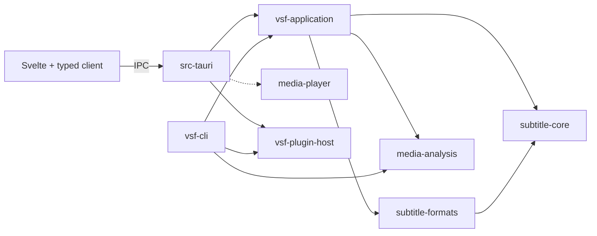

# Architecture

VisualSubForge is a desktop subtitle editor built with Rust, Svelte, TypeScript
and Tauri. This is the authoritative overview of the implemented architecture.
[Current status](docs/status.md) records implemented scope and release limits.
PR descriptions record validation results; the [test guide](tests/desktop/README.md)
describes reproducible commands and their scope.

The design keeps accepted subtitle state in Rust, transient interaction state in
Svelte, and native playback behind a narrow boundary. Desktop and CLI callers
share application operations without requiring a running GUI. Native playback
remains experimental; its implementation does not establish platform acceptance.

## Code map and dependencies

Arrows show the main call/dependency paths. The dashed arrow is optional native
playback, enabled by `media-prototype` (also enabled by `macos-angle`). The desktop
also calls the domain, formats and analysis crates directly; build/test dependencies
and external libraries are omitted. The table explains each boundary.

| Location | Responsibility and dependency boundary |
| --- | --- |
| `crates/subtitle-core` | Cue identities, millisecond times, document invariants, edits and undo/redo. No external crate, filesystem, UI or media dependency. |
| `crates/subtitle-formats` | SRT, ASS/SSA and WebVTT parsing, source preservation and serialization. Depends only on the domain; performs no filesystem IO. |
| `crates/vsf-application` | Shared checking, repair proposals, authoring, conversion, translation, resynchronization and file policies. Uses domain/formats and `media-analysis`; has no Tauri or native playback dependency. |
| `crates/vsf-cli` | Arguments, signals, reports and exit codes for headless operations. Composes application operations with the plugin host when needed. |
| `src-tauri` | Desktop startup, typed command adapters, accepted document/project owners, background services and native window integration. |
| `src/lib` and `src/App.svelte` | Components, transient session owners, typed client and pure timeline/selection calculations. |
| `crates/media-analysis` | Bounded FFmpeg/ffprobe subprocesses for probing, waveforms, scenes and alignment. Independent of subtitle state and Tauri. |
| `crates/media-player` | Native player/graphics adapters and audited Rust FFI. Independent of subtitle domain types. |
| `crates/plugin-host` | Package name `vsf-plugin-host`: JavaScript engine and bounded helper-process transport. Production dependencies exclude the application and domain. |

The desktop and CLI call `vsf-application` directly. The application plugin API
accepts an injected executor; it does not depend on the JavaScript engine crate.
Optional schema derives support desktop bindings without pulling Tauri into
shared operations. Actual build dependencies are declared in each `Cargo.toml`.

These boundaries are partly logical. Desktop document-session coordination still
lives in `src-tauri/src/document.rs` and its submodules, alongside IPC projections.
`App.svelte` is the workspace composition root: it constructs sessions, wires
callbacks and delegates its short action switch to subtitle/project-file, media,
cue-editing and view/panel action functions. `Workspace` owns task activity and messages and
derives shared gates from modal, decision and gesture activity.
Cue-table, cue-editor, waveform and shell markup live in components receiving the
relevant owners. WorkspaceToolbar, RecoveryBanner, WorkspaceFooter,
PlaybackDiagnostics and FontDiagnostics retain scoped styles; WorkspaceDialogs
renders feature content from the modal identity. TransportBar, CueOperationsBar, SubtitleToolbar and VideoPreview own their region
markup and scoped styles. WorkspaceDecisions and WorkspaceLegacyImport render
decision-owned payloads; ActionBrowser presents command discovery and searchable keyboard help. App creates owners and
lays out regions.
Action labels, aliases and shortcut descriptions live in
`workspace/action-descriptions.json`, imported by the frontend and embedded by
Rust's native menu builder. Version-5 preferences hold validated bindings by
focus mode; bundled presets share one JSON source across Rust and TypeScript.
The pure workspace router resolves those bindings while retaining composition,
repeat, text-history and Windows fallback rules. `WorkspaceCommands` derives discovery eligibility and delegates commands
to existing owners after modal close; it owns no accepted state or background
work. Cue jumps recheck the captured document before entering ordinary protected
selection. Native menus retain their platform layout and eligibility projection.

The command palette, Commands menu and shortcut sheet use `WorkspaceModal` and
`HideVideo` for hide-before-presentation, close ordering and return focus.
`Tooltips` owns one delayed tooltip and delegates the same native-video lifetime
to `HideVideo`; cancellation/disposal retires its timer and pending presentation.
Modal/menu admission retires hover presentation first, and active workspace
operations/modals/menus block new tooltips. Other overlays include active tooltips when restoring remaining occlusion, and
tooltips preserve active modal/menu/diagnostic occlusion. Tooltip presentation
never changes a document or admits an operation.

Appearance comes from `src/lib/ui/`: `tokens.css` defines the dark and light
palettes, type and shape, and `base.css` styles native elements. Components use
tokens in their scoped styles instead of color literals. The waveform canvas reads
tokens through `canvas-palette.ts` and redraws when the theme or loaded fonts
change. The page body stays transparent so the native video surface can show
through; the visible window color is painted by the video placeholder.
CueNavigation coordinates selection, following, reveal and focus through narrow
DOM callbacks. WorkspaceStartup loads initial state, WorkspaceMenus owns the native
menu subscription, and NativeVideoLayout owns native layout tracking;
WorkspaceView owns only panel toggles and their open/close rules. WorkspacePreferences
owns saved defaults, effective timing and quality invalidation; WorkspaceScenes owns
scene controls and projections. MediaSession owns the chosen path/hardware policy,
and TimelineView owns playback following and waveform interaction state.

## Start reading the code

Follow the cue-edit walkthrough below, then read these entry points in order:

1. [main.rs](src-tauri/src/main.rs): constructs desktop owners and wires startup/exit.
2. [document.rs](src-tauri/src/document.rs): follow `document_action` into
   `Documents::apply` and `Store::apply` to see version checks and accepted state.
3. [editor.rs](crates/subtitle-core/src/editor.rs): follow `apply_edit` and history
   publication; [source.rs](crates/subtitle-formats/src/source.rs) supplies format policy.
4. [DocumentSession](src/lib/document/document-session.svelte.ts): follow draft submission
   and accepted-reply reconciliation through the [typed client](src/lib/client.ts).

## Accepted state and transactions

`Documents` owns a mutex-protected `Store`. Its loaded document contains one
`Editor<Source>`, the source path and saved-byte baseline, save-protection flags,
and translation context. The store also coordinates quality policy and feature
jobs. The frontend and analysis workers do not own the live accepted editor.

`Editor<Source>` owns cues, immutable format properties, revision and undo/redo
history. Cue IDs remain stable independently of table position. History records
the replaced cue span and, when changed, document properties. It does not take a
whole-document snapshot for every single-cue edit. Saved-state identity is
separate from revision, so Undo can return to saved content while revisions keep
advancing. Format properties participate in the same transaction as cue edits.

A document generation identifies replacement/open/recovery; a revision identifies
accepted edits within that generation. Document-edit requests carry both. Rust checks
them before committing and validates candidate output against format and size
policy. Rejected edits preserve accepted content, history and saved state.
Read-only checks can report quality problems without preventing legitimate edits.

The document mutex is the transaction boundary for accepted state and related
context. Moving code between modules must preserve that boundary. Splitting
locks or introducing another mutable owner requires a separate concurrency design.

## Error boundaries

`subtitle-core::Error` names domain failures and retains revision, cue identity
and time-range context. Editor validators return application-owned messages;
the editor wraps rejection in `ValidationRejected` without interpreting format,
size or IO policy. Validation still precedes history/identity publication, and
rejection preserves the existing editor, redo, revision and saved-state identity.

`subtitle-formats::Error` covers format dispatch, extension validation and SRT
parsing/serialization, including nested line and domain context. ASS/SSA and
WebVTT internal APIs still return their detailed messages; dispatch distinguishes
parse from validation failures and attaches the format. Application policies
retain their existing report errors. Text adapters use the errors' `Display`
implementation at those boundaries, preserving CLI reports and other command
messages. The document IPC command returns a generated tagged error: stale revision,
replaced document, rejected operation or unknown outcome (`outcomeUnknown`). Version checks occur
under the existing document mutex before mutation; the client preserves the tag
and message in `DocumentFailure`. Unknown transport/worker outcomes are distinct
from confirmed rejection. Error types add no worker, lock or document owner.

## Frontend ownership and reconciliation

| Owner | State it owns |
| --- | --- |
| `Workspace` | Workspace task counter, readiness, error and notice; derives busy and confirming from owner activity and exposes the shared admission check. |
| `DocumentSession` | Replacement-only accepted projection, selection and text/time/style drafts; serialization and reconciliation of document commands. |
| `CueEditing` | Pause/blur/IME/Escape triggers, focus identity and cancellable auto-commit timer. It owns no accepted history. |
| `CueFixes` | Debounced selected-cue repair admission, bounded polling and stale/disposal guards; the existing Rust timing worker owns the plan. |
| `TimingGesture` | Held-Space timing, boundary preview/captured version, magnetic targets and range/loop restoration. It exposes activity; Workspace derives the gate and owns messages. |
| `CueTableView` | Filtered file-indexed rows, fixed-density virtualization, column projection and active cue IDs. App supplies accepted cues/playback reads; CueTable owns its DOM observer and cleanup. |
| `TimelineView` | Waveform viewport, selection range and live-loop preview updates, visible cues, duration, analysis start/polling and stale-reply rejection. App supplies playback and gesture state. |
| `MediaSession` | Playback projection, polling and response ordering, plus serialized/coalesced live-loop requests. |
| `ProjectWorkflow` | Project attachment projection and ordered open/save/quit continuations. Rust owns the persisted identity. |
| Feature sessions | Dialog inputs, bounded review projections, request identities and cancellation/disposal. Rust owns proposals and acceptance. |
| `WorkspaceDecision` | Unsaved-work, project-save-failure, project-reference and legacy-import hide/wait/answer lifetimes. Decisions own typed display payloads; LegacyImportDecision also owns return focus. App supplies media callbacks; Workspace derives confirming; save/exit policy stays in UnsavedChanges and ProjectWorkflow. |
| `HideVideo` | Shared hide-before-show, render-before-restore, remaining-occlusion, epoch and disposal lifecycle for modals, decisions and the cue menu. |
| `CueMenu` | Captured cue/range context, menu replacement, command activity and menu focus lifetime. |
| `Recovery` | Recovery listing, polling/response epochs, discard confirmation and recovery action activity. |
| `WorkspaceDialogsState` | Dialog eligibility, inputs and post-close continuations over WorkspaceModal identity; accepted content remains with DocumentSession. |
| `WorkspaceModal` | Modal identity/transitions, native-video hide/restore ordering and return focus for command discovery/keyboard help, styles/fonts/conversion/plugins, timing reviews, Settings, resync, statistics and text tools. |
| `CueNavigation` | Selection/focus/reveal orchestration, pending problem navigation and cue-following effects; uses workspace tasks without assigning the gate. |
| `WorkspaceView` / `WorkspaceLayout` | Panel visibility/rules and measured pane sizes/splitter constraints, respectively. |
| `WorkspacePreferences` | Saved defaults, effective project timing, metric visibility and quality-context invalidation, updated through initialization, acceptance and restore methods. |
| `WorkspaceScenes` | Scene visibility, cuts, controls, status and restored-generation projection. |
| `UnsavedChanges` | Subtitle save and the unsaved-changes guard; each caller supplies its project-save continuation. |
| `TranslationReference` | Protected reference attach/copy/offset/detach actions and lifetime guards. |
| `WorkspaceStartup` / `WorkspaceMenus` | Initial state loading and native menu projection/subscription, respectively; each guards late replies after disposal. |
| `NativeVideoLayout` | Coalesced native layout requests, resize observer, window listeners and polling timer; disposal removes all subscriptions and suppresses late replies. |
| `App.svelte` | Owner construction, narrow DOM callbacks, short action dispatch and screen regions. |

Decision payloads are published only after native video hides and are cleared before
restoring remaining occlusion and settling the answer. LegacyImportDecision keeps
publication/open continuation and return focus together; no external open-flag shim
is needed. UnsavedChanges does not depend on ProjectWorkflow: callers explicitly
supply the appropriate save continuation, including the project operation's own
save context. TranslationSession clears hidden reference queries in its initialization
scoped effect; TranslationReference handles user file operations and quality invalidation.

Panel rules preserve existing distinctions: explicitly closing Problems cancels its
pending navigation, toggling Translation only hides Problems, and Statistics can
reveal Problems while retaining Translation visibility. Preference initialization,
Settings acceptance and project timing restoration each update the related fields
through one owner method; project timing never replaces saved defaults.

WorkspaceModal, WorkspaceDecision and CueMenu delegate native-video transitions
to HideVideo. Modal admission failures are reported and modal close restores focus;
decision admission failures propagate and decisions settle their answer after close.
The menu permits replacement while visible and retains its immediate return-focus
policy. The shared lifecycle waits for native-video hiding before exposing content.
Closing removes content, waits for rendering, restores the remaining diagnostics
occlusion, then releases the workspace gate before restoring focus. A close during
opening waits for that hide reply; disposal invalidates continuations and leaves
native cleanup to media teardown. Workspace derives its overlapping authoring gates from
this owner and supplies DOM/media callbacks and feature eligibility. Dialogs/sessions
still protect pending acceptance and own their drafts; project-save and unsaved-work
continuations retain their separate owners. Overlapping feature visibility derives from the modal identity.
The docked Review panel keeps Issues, timing repairs, Shift and Statistics beside
the cue list; it does not use HideVideo. WorkspaceView owns its tab/purpose and
transient acceptance busy state. Acceptance gates competing workspace actions;
read-only previews do not. Statistics verifies its captured document/media/quality/scene
version before protected navigation; text navigation rechecks document identity and drafts
before selecting a cue and restoring its UTF-16 selection. Settings persistence
epochs and picker guards remain in the dialog. Legacy import and project decisions
share WorkspaceDecision presentation; publication and save/exit continuations
remain separate. CueMenu retains its captured context and focus lifetime over the shared HideVideo lifecycle.

CueNavigation applies drafts before explicit selection, preserves captured-document
checks and keeps automatic following separate from seek-producing selection. DOM
access is limited to viewport reads, scrolling and focus callbacks. Its operations use Workspace.task; accepted state and undo remain in Rust. Effect-bearing
owners are constructed during component initialization.
Named cue-editing, workspace-quality and workspace-menus modules derive the current
projections; UnsavedChanges and project-view retain save/restore policy and sequencing.

Stateful and lifetime-bearing owners are classes; stateless actions and derivations
are functions. App constructs dependencies first, explicitly connects the remaining
callback graph before mount, and registers each disposal beside construction through
`disposeWithComponent`. Cleanup guards are invalidated synchronously; media stops
its live loop before gesture/timeline teardown, and decision promise continuations
run after every owner is disposed. CueTable owns its list observer. NativeVideoLayout
owns and removes its resize observer, window listeners and 100 ms timer, coalesces
in-flight requests and suppresses late replies. Workspace.task counts nested and
overlapping operations, so an inner completion cannot release the outer busy gate.

Session objects live for a component/workspace mount and are disposed explicitly.
Accepted snapshots use replacement-only `$state.raw`; components do not mutate
accepted cue objects. Drafts and gesture previews remain separate. A gesture
commits the document version captured when it began, not a newer version that
happened to arrive before release.

Async owners check request epochs and captured document/media/context identity
before publishing replies. Closing during a pending start also cancels the job
when its ID eventually arrives. Disposal suppresses late UI updates and follow-up
commands; it cannot undo a mutation already accepted by Rust. Acceptance flows
that reconcile a lost reply fetch authoritative state before continuing.

Gap, scene, duration and batch timing share `TimingRepairSession` for
start/read/page/cancel/accept ordering and disposal. Live dock inputs debounce
250 ms and compare semantic keys so unrelated playback updates cannot starve
admission. Pure read-only admission retries stop after three attempts; mutations
are never retried. The capture is reactive and accepted snapshots remain immutable.
Coverage eligibility stays in feature wrappers. Gap alone permits no-media
acceptance, with an explicit note beside Apply; missing attached-media scene
coverage remains protected. Completed plans poll for Rust-owned invalidation.

Rust's `quality::timing_selection` prepares the selected subset on the existing
worker, checks repaired candidates against the whole document and captured
profile/scene context, and refuses unsafe coupled subsets. Explicit shifts retain
their documented overlap semantics. Acceptance revalidates the immutable capture
and applies one history operation. Full plans stay in Rust: review pages contain
100 rows; an independent projection requests at most 200 visible cue IDs for
frontend dashed ghosts and list deltas. Those projections cannot mutate accepted
state, and disappear on context changes, closure or disposal. Statistics retains
its separate request/epoch owner, translating list IDs to its existing selection
contract and recalculating read-only reports on changed inputs.
Other sessions retain distinct lifetimes, including file publication and reference
queries. Similar field names alone do not imply interchangeable cancellation.
See the [frontend walkthrough](src/lib/README.md) for feature-specific behavior.

`workspace-keys.ts` owns keyboard routing and editing shortcuts. Its pure routing
function preserves shortcut precedence and focused-control exceptions; handlers
receive workspace/session owners and focus/navigation callbacks. Action modules
read current owner state after awaits, keeping draft reconciliation before cue
planning. They introduce no registry or second accepted-state owner.

## Two end-to-end paths

### Commit a cue edit

1. The component edits a local draft. `DocumentSession` captures its generation,
   revision and cue identity and sends an action through `src/lib/client.ts`.
2. The Tauri handler dispatches blocking work; `Documents` serializes it under
   the document mutex and rejects stale versions.
3. Application/format policy prepares the edit. `Editor<Source>` validates and
   publishes one history transaction, then Rust returns an accepted projection.
4. `DocumentSession` replaces its projection and reconciles drafts/selection.
   Background recovery and subtitle preview observe the accepted revision.

`CueEditing` commits after a 700 ms typing pause, ordinary blur, protected cue
navigation or a cue command. IME composition defers pause/blur; Escape cancels an
unsent timer, waits for a dispatched commit and restores the latest confirmed
accepted fields. Modal/decision focus transfers keep their existing draft
protection: blur cannot mutate underneath a newly mounted review or Save/Discard
choice, and returning to an available workspace starts a fresh pause interval.
There is no file autosave change. The interaction timing remains subject to owner
trial; see the [cue editor guide](docs/cue-editor.md).

An optional opaque focus-session argument accompanies text commits through the
same command boundary. Rust supplies its monotonic timestamp. The core merges
validated same-cue, text-only commits in one focus with at most five seconds idle,
keeping the first before state and latest after state. Every accepted commit still
advances revision and content identity. Timing/style/structural edits, ungrouped
commands, Undo/Redo and save checkpoints seal the group. Failed validation does
not alter history. No frontend clock or undo stack authorizes merging.

A stale/refused-version or unknown-outcome commit performs one authoritative
status read and retains the latest draft without replay. A failed refresh marks
accepted state unconfirmed; the next explicit retry is read-only, then requires
review before mutation. Deleted/replaced targets clear selection so retained text
cannot attach to another cue. Known rejection retains an inline error and stops
automatic retries until new input or an explicit retry. Newer input during an
automatic success remains a draft; an explicit navigation/command waits for that
request, then commits the latest fields once. Manual continuations still stop if
newer input arrives during their own commit. Disposal retires timers and follow-up
reads and suppresses late adoption; it cannot reverse an accepted Rust commit.

Formatting flushes existing fields, captures a version and source selection,
checks the reply against live inputs, then accepts the formatted text as a separate
ungrouped command. Rust remains the sole formatting/validation/history owner.

Selected-cue issue pages are independent of Problems filters and bounded to 200.
They include related-cue findings, group CPS/RS findings and sort violations first.
The fixed-height strip renders three chips; overflow uses WorkspaceModal/HideVideo
and pages the complete result. Meters and source-line counts use Rust projections.

Safe cue fixes reuse the existing single timing-proposal worker, cancellation,
10-second deadline and media → scenes → document acceptance lock order. The pure
application planner composes deterministic text and timing operations, keeps only
the selected cue, and validates whole-document non-worsening before publishing an
immutable plan. Coupled text/duration changes are checked together. One validated
`UpdateBatch` is one Undo entry. No split, inferred spelling choice or missing-scene
acknowledgment is automatic; at most 200 deterministic language corrections are
considered per preparation. Opening another modal retires the transient plan.
Failed acceptance refreshes authoritative state and is never blindly replayed.

Nominal frame cadence is read by the existing native control worker, without new
native resources. Frame nudges quantize once to format precision. Unavailable
cadence disables nudges, and variable-rate boundary accuracy is not claimed.

### Review and accept a batch operation

1. The frontend resolves drafts when required and requests a review for explicit
   inputs. Rust admits bounded work and captures immutable document/context data.
2. A worker computes a proposal outside the document lock. The frontend reads
   bounded pages; it does not reconstruct accepted edits from displayed rows.
3. Acceptance checks the proposal's current document, policy and any media/scene
   identities. Additional source/package checks run where the operation requires.
4. Rust commits the complete validated plan as one history operation.
   `DocumentSession` serializes adoption with ordinary edits.

Conversion and legacy-project publication instead write separate files. Their
success does not adopt a document or alter its undo history. A successful write
can outlive a cancellation request, so these flows retain an authoritative receipt.

## Work scheduling and resource lifetime

Blocking IO, analysis and helper execution run off the UI thread. Tauri handlers
translate inputs/outputs and delegate to owners through blocking tasks or the
media control worker. Shared application file operations are synchronous; their
desktop callers are responsible for dispatching them correctly.

Document jobs capture immutable inputs under the owner lock, then evaluate
outside it. Revision/context checks protect result publication and acceptance.
Explicit review services use bounded admission rather than unbounded queues;
scene/duration/batch share one timing worker, and text/style/font/conversion share
another. Waveform and scene analysis each allow one active request and one
replaceable pending request. Replacement cancels obsolete work before reuse.

Scene capture and guarded document work have different lock lifetimes. During
gap, timing, statistics and plugin start, `Media::with_context` holds media selection
while `capture_quality` copies scene data. That scene guard is released before
acquiring the document lock.

For protected reads and acceptance where supported, callers nest
`Media::with_context`, `Scenes::with_quality_current` and the document operation:
**media selection → scenes → document** remain locked together. This covers
[gap](src-tauri/src/gap_review.rs), [timing](src-tauri/src/timing_review.rs),
[statistics](src-tauri/src/statistics.rs), [plugin review](src-tauri/src/plugin_review.rs)
and [quality checks](src-tauri/src/quality_check.rs). Quality reads first capture
scene data, then reacquire and validate the scene guard before document access.
Holding the outer guards prevents a rescan or media replacement between validation
and the protected read/commit. See the [scene guards](src-tauri/src/scenes/context.rs).

Project attachment/publication orders document before project. Blocking worker
waits and shutdown joins happen outside these transaction locks. Open/save can
currently hold the document mutex during filesystem IO on a blocking worker.
Playback preview tries the document lock without waiting, so a save cannot stall
transport just to obtain a fresh subtitle preview.

Cancellation is cooperative across application IO and analysis checkpoints;
ordinary filesystem calls cannot be forcibly interrupted. Subprocess supervisors
enforce output/deadline limits and terminate/reap owned children. Shutdown stops
admission, cancels work and joins workers off the UI thread. Recovery keeps a weak
store reference so the background loop alone cannot keep the store alive after
the workspace owner is dropped.
Conversion publication also uses a weak reference: after preparing output it must
obtain the still-live owner and revalidate context before committing. Other workers
own captured inputs/job state, not an independent accepted document.

The plugin host creates a fresh helper process/runtime for each invocation.
JavaScript values stay on that helper's execution thread. The parent bounds
pipes, deadlines and cancellation and reaps the child. The desktop launches the
installed sibling CLI in helper mode; it does not discover an executable on PATH.
Engine limits are not an OS sandbox. See the [plugin contract](docs/plugin-host.md).

## Persistence and recovery

Format adapters preserve supported source information; application policy owns
bounded reads and serialization limits. `vsf-application::document_save` owns
loaded-editor Save/Save As eligibility and publication, borrowing the existing
editor, path, byte baseline and protection flags exclusively. The desktop supplies
reference/copied-source paths and keeps the document mutex locked on its blocking
worker; the shared operation introduces no second state owner or worker.
Saves serialize first, acquire a
destination lease, compare the saved-byte baseline when overwriting the current
source, and atomically replace the file through a temporary sibling. Only a
successful replacement updates the editor’s saved identity, path, byte baseline
and recovery/resync flags, while the lease is still held. Reference and copied-source
protection remains caller-owned and survives saves. The CLI retains its separate-output
publication policy. Failures preserve the
previous file and dirty document.

Leases coordinate participating VSF writers. They do not prevent arbitrary
external editors from racing a save. Recovery and protected source-copy workflows
require explicit Save As; their protection is separate from undo history.

A recovery worker captures accepted state, prepares temporary output off-lock,
then rechecks its checkpoint identity before publication. Recovery restores
accepted content and relevant context, not frontend drafts or undo history.
Projects separately persist references, effective settings, completed scene data
and paused position. Project preflight/restoration precedes attachment; failed
restoration cannot adopt the old project's save identity for the new workspace.
See the [recovery owner](src-tauri/src/document/autosave.rs) and
[project store](src-tauri/src/project/store.rs).

## Time and transport boundaries

The domain uses `CueId` and integer `Milliseconds`. SRT/WebVTT use millisecond
ticks; ASS/SSA output uses 10 ms ticks. Format-aware operations validate or round
at their documented conversion boundary. Native playback exposes seconds as
floating-point values; missing clock values remain unavailable rather than
becoming zero. Timeline helpers convert explicitly before committing edits.

All frontend/backend application communication goes through `src/lib/client.ts`.
`src-tauri/src/ipc.rs` supplies the command/event registry and generated TypeScript
contracts. The client exposes short aliases; generated names are not a domain API.
Checked integer codecs reject values outside JavaScript's exact range, and required
floating-point outputs must be finite. Optional native measurements may be null.
`npm run ipc:check` detects generated-contract drift.

## Native media boundary

One media control worker owns the native player and playback session. Native
surface creation and window changes respect the platform UI thread. Mac rendering
uses a dedicated render worker, Linux GLArea rendering belongs to GTK's main
context, and Windows delegates rendering to mpv's video output. Native rendering
on a platform UI thread does not permit blocking analysis or file IO there.

Teardown releases the render context/resources before destroying the player core,
then removes the native surface on its required thread. Decoded frames stay in
the native rendering path; ordinary commands/events carry status, geometry,
waveform peaks, scene markers and other bounded data. Accepted subtitle preview
is serialized for the native player without transferring video pixels through IPC.

The default editor build supports subtitle work without native playback.
`media-prototype` and `macos-angle` opt into native integration. Runtime patches,
build provenance, platform differences and remaining adoption gates are described
in the [native maintenance contract](docs/native-runtime.md).

## Maintaining this overview

Update this file when implemented ownership or dependencies change. Explain the
reason and validation in the change description, and identify proposed work there
until implemented and verified. Feature contracts and
[CONTRIBUTING.md](CONTRIBUTING.md) hold detailed behavior and checks.
This overview must remain usable from a fresh clone without local research or
historical decision/task records.

## Workspace layout preferences

`WorkspaceLayout` owns the active preset, independent sizes for five presets,
measured control heights and coalesced resize/persistence work. Pure slot math
reserves preview, transport, cue rows and two text lines before applying ratios.
CSS slot placement keeps the waveform, native placeholder, table and editor
mounted. Preset changes and splitter updates use `HideVideo`: acknowledge hiding,
change placement, render, drain native layout and acknowledge current bounds,
then restore remaining occlusion. Its activity joins the workspace admission gate;
disposal retires queued changes, the save timer and late continuations.

Pane saves debounce for 250 ms and serialize one write plus the newest pending
snapshot. Save acknowledgments update saved preferences without replacing newer
transient geometry or invalidating quality. Failures keep the current layout and
report an error. The narrow `layout_save` command performs blocking persistence
outside the UI thread and never acquires the document lock or accepts a quality
policy. All production settings-file writes serialize read/modify/write under one
writer mutex, preserving unrelated layout, profile and personal-word fields.
Document preference/word operations acquire the document lock before this writer;
layout writes acquire only the writer. Atomic publication permits concurrent reads
of either complete version. Versions 1–4 migrate in memory to version 5; the historical
settings filename remains valid. Custom arrangements use a bounded version-1
row schema: seven distinct panel kinds, at most two per row, integer weights and
split percentages. Pure frontend geometry refuses moves that exceed the current
viewport and preserves panel minima through scrolling when a saved layout is
restored in a smaller window.

Arrange Panels pauses playback, then uses WorkspaceModal/HideVideo for its whole
lifetime. Nested layout transitions retain modal occlusion and acknowledge native
bounds before closing. CSS slots move existing mounted components; hiding Video
retains its zero-size placeholder shadow to paint the window without an opaque
body. Review and Statistics share their existing dock owner. Tool visibility
reconciles custom slots; if a revealed tool cannot fit, it selects the corresponding
standard preset. No floating surface or additional worker is created.

WorkspaceLayout keeps user defaults separate from the optional project override.
Project version 3 stores a validated layout snapshot through the existing atomic
project writer. Without a layout, saves retain version 1 for media projects or
version 2 for subtitle-only/translation projects, including quit/view saves;
removing the layout returns to that compatible version. Versions 1/2 remain
readable and are not rewritten on open.
Restoring project options awaits guarded hide/render/bounds completion before
publishing the frontend attachment. Old projects restore user defaults. Explicit
Save project layout reuses the guarded view-save path without saving subtitle
bytes; removing the override requires saving its null snapshot. The Arrange
checkbox changes scope immediately, with pending durability stated in the UI.

## Cue columns and issue projections

Column order, visibility, whole-CSS-pixel widths and fixed row density belong to
WorkspaceLayout's per-preset presentation preferences and existing serialized
save queue. Rust validates the complete model, mandatory Issues/Text columns and
width bounds before atomic publication. The chooser uses WorkspaceModal/HideVideo;
resizing stays inside the list. Actor is a read-only projection of existing ASS/SSA
Name metadata. No column operation changes subtitle content or history.

CueTableView derives filtered rows once from accepted cues, query and issue index,
retaining original file indices for numbering and metric windows. Keyboard ranges
and Select All use visible order. CueNavigation distinguishes acknowledged
programmatic scrolling from manual scrolling: clicking retains following; manual
scrolling pauses it; Jump clears filters and resumes subject to draft protection.

QualitySession retains the existing single in-flight request lifetime. It pages
Rust findings into a highest-severity-per-cue index (including related cues), and
caches at most 32 windows of at most 200 accepted metrics. Problems filters/pages
remain independent. Report identity, revision/context changes, failures and disposal
prevent stale publication. Incomplete indexing is visible; no frontend quality rules
are evaluated. The mandatory issue column enables accepted checking for loaded
documents; explicit Pause checking remains available.

## Instant Settings and shortcut publication

`SettingsSession` owns the mounted dialog draft, last confirmed preference snapshot,
one settings Undo checkpoint and a 250ms debounce. It serializes writes, retaining
only the newest unsent draft. Rust validates and persists the complete policy and
returns its next epoch; accepted policy/history remain Rust-owned. Invalid raw
controls remain mounted across sidebar changes and prevent persistence. A failed
or missing save reply blocks automatic writes; read-only reconciliation checks the
stored preferences and effective policy/word epoch. Only explicit Retry sends a
new mutation. Disposal ignores late replies without claiming cancellation of an
already dispatched Rust operation. Settings Undo changes preferences, not subtitle
history. Closing flushes valid drafts; discarding an invalid draft is explicit.

Native accelerator publication runs in the existing blocking preference operation.
Tauri marshals menu changes to its UI thread; no filesystem work moves there.
Lock ordering is document → shortcut runtime → settings writer; layout writes
acquire only the writer. All accelerators are cleared before new primary global
bindings are installed. Publication or persistence failure restores the last
confirmed accelerator set; failed rollback reports that restart is required.
The runtime advances only after successful persistence. Scoped and alternate
bindings dispatch in the webview; primary native bindings use menus, with the
existing unconsumed Windows fallback. Text formatting/history, Escape and OS keys
retain their owners. Ordinary cue-row focus belongs to the list shortcut mode;
other buttons retain Enter/Space activation and other fields retain Tab navigation.

The mode-aware preset remains opt-in pending owner trials. Migrated settings keep
current bindings except Replace moves to Cmd/Ctrl+Shift+F to resolve the macOS
Merge Previous collision. See [Settings and shortcuts](docs/settings-shortcuts.md).
Distinct cue counts per quality rule are computed once from the accepted report
on the existing cancellable worker, deduplicating primary and related cue IDs.
The bounded projection uses the same report identity/epoch and stale guards as
`QualitySession`; there is no frontend evaluator or extra analysis worker.

## Timeline visual projections

The waveform, full-file minimap and video scrubber remain frontend projections.
`timeline-marks.ts` computes display geometry and bounded cue-density bins;
accepted cue issue severities come from `QualitySession`. Gap colors and cut
warnings describe the effective profile, without adding a frontend quality
report or changing accepted timing. `snapBoundary` returns the reference for its
selected legal endpoint; captured original cue indices supply descriptive labels.
The existing gesture owner alone commits cue timing, with its stale-version guards.

`SceneOverview` reads completed visual cuts through existing `scenes_view` calls.
One read is in flight; truncated windows subdivide, bounded to 128 reads and
100,000 retained cuts. Generation, media identity, epoch and disposal retire late
results. Incomplete/error/bounded coverage stays explicit. It does not start or
cancel scans, introduce a Rust worker, or treat visible-window cuts as full-file
coverage. Minimap drawing bins density, issues and cut ticks independently of
playhead redraws. Pointer capture cancels on resize, media replacement, disabling,
blur or disposal. The scrubber holds only a transient position and seeks once on
release through the existing media owner. It is a DOM sibling below the native
surface; the existing bounds observer tracks that smaller surface rectangle.
