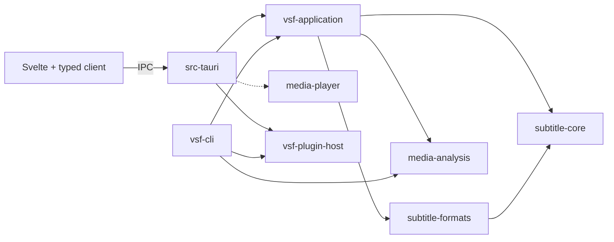

# Architecture

VisualSubForge is a desktop subtitle editor built with Rust, Svelte, TypeScript
and Tauri. This is the authoritative overview of the implemented architecture.
[Current status](docs/status.md) records feature validation and release limits.

The design keeps accepted subtitle state in Rust, transient interaction state in
Svelte, and native playback behind a narrow boundary. Desktop and CLI callers
share application operations without requiring a running GUI. Native playback
remains experimental; its implementation does not establish platform acceptance.

## Code map and dependencies

Arrows show the main call/dependency paths. The dashed arrow is optional native
playback, enabled by `media-prototype` (also enabled by `macos-angle`). The desktop
also calls the domain, formats and analysis crates directly; build/test dependencies
and external libraries are omitted. The table explains each boundary.

| Location | Responsibility and dependency boundary |
| --- | --- |
| `crates/subtitle-core` | Cue identities, millisecond times, document invariants, edits and undo/redo. No external crate, filesystem, UI or media dependency. |
| `crates/subtitle-formats` | SRT, ASS/SSA and WebVTT parsing, source preservation and serialization. Depends only on the domain; performs no filesystem IO. |
| `crates/vsf-application` | Shared checking, repair proposals, authoring, conversion, translation, resynchronization and file policies. Uses domain/formats and `media-analysis`; has no Tauri or native playback dependency. |
| `crates/vsf-cli` | Arguments, signals, reports and exit codes for headless operations. Composes application operations with the plugin host when needed. |
| `src-tauri` | Desktop startup, typed command adapters, accepted document/project owners, background services and native window integration. |
| `src/lib` and `src/App.svelte` | Components, transient session owners, typed client and pure timeline/selection calculations. |
| `crates/media-analysis` | Bounded FFmpeg/ffprobe subprocesses for probing, waveforms, scenes and alignment. Independent of subtitle state and Tauri. |
| `crates/media-player` | Native player/graphics adapters and audited Rust FFI. Independent of subtitle domain types. |
| `crates/plugin-host` | Package name `vsf-plugin-host`: JavaScript engine and bounded helper-process transport. Production dependencies exclude the application and domain. |

The desktop and CLI call `vsf-application` directly. The application plugin API
accepts an injected executor; it does not depend on the JavaScript engine crate.
Optional schema derives support desktop bindings without pulling Tauri into
shared operations. Actual build dependencies are declared in each `Cargo.toml`.

These boundaries are partly logical. Desktop document-session coordination still
lives in `src-tauri/src/document.rs` and its submodules, alongside IPC projections.
`App.svelte` is the workspace composition root: it constructs sessions, wires
callbacks and dispatches actions. `Workspace` owns task activity and messages and
derives shared gates from modal, decision and gesture activity.
Cue-table, cue-editor and waveform markup live in components that receive the
relevant owners. DOM focus and native layout coordination remain at the root.

## Start reading the code

Follow the cue-edit walkthrough below, then read these entry points in order:

1. [main.rs](src-tauri/src/main.rs): constructs desktop owners and wires startup/exit.
2. [document.rs](src-tauri/src/document.rs): follow `document_action` into
   `Documents::apply` and `Store::apply` to see version checks and accepted state.
3. [editor.rs](crates/subtitle-core/src/editor.rs): follow `apply_edit` and history
   publication; [source.rs](crates/subtitle-formats/src/source.rs) supplies format policy.
4. [DocumentSession](src/lib/document-session.svelte.ts): follow draft submission
   and accepted-reply reconciliation through the [typed client](src/lib/client.ts).

## Accepted state and transactions

`Documents` owns a mutex-protected `Store`. Its loaded document contains one
`Editor<Source>`, the source path and saved-byte baseline, save-protection flags,
and translation context. The store also coordinates quality policy and feature
jobs. The frontend and analysis workers do not own the live accepted editor.

`Editor<Source>` owns cues, immutable format properties, revision and undo/redo
history. Cue IDs remain stable independently of table position. History records
the replaced cue span and, when changed, document properties. It does not take a
whole-document snapshot for every single-cue edit. Saved-state identity is
separate from revision, so Undo can return to saved content while revisions keep
advancing. Format properties participate in the same transaction as cue edits.

A document generation identifies replacement/open/recovery; a revision identifies
accepted edits within that generation. Document-edit requests carry both. Rust checks
them before committing and validates candidate output against format and size
policy. Rejected edits preserve accepted content, history and saved state.
Read-only checks can report quality problems without preventing legitimate edits.

The document mutex is the transaction boundary for accepted state and related
context. Moving code between modules must preserve that boundary. Splitting
locks or introducing another mutable owner requires a separate concurrency design.

## Error boundaries

`subtitle-core::Error` names domain failures and retains revision, cue identity
and time-range context. Editor validators return application-owned messages;
the editor wraps rejection in `ValidationRejected` without interpreting format,
size or IO policy. Validation still precedes history/identity publication, and
rejection preserves the existing editor, redo, revision and saved-state identity.

`subtitle-formats::Error` covers format dispatch, extension validation and SRT
parsing/serialization, including nested line and domain context. ASS/SSA and
WebVTT internal APIs still return their detailed messages; dispatch distinguishes
parse from validation failures and attaches the format. Application policies
retain their existing report errors. Text adapters use the errors' `Display`
implementation at those boundaries, preserving CLI reports and other command
messages. The document IPC command returns a generated tagged error: stale revision,
replaced document, rejected operation or unknown outcome (`outcomeUnknown`). Version checks occur
under the existing document mutex before mutation; the client preserves the tag
and message in `DocumentFailure`. Unknown transport/worker outcomes are distinct
from confirmed rejection. Error types add no worker, lock or document owner.

## Frontend ownership and reconciliation

| Owner | State it owns |
| --- | --- |
| `Workspace` | Workspace task flag, readiness, error and notice; derives busy and confirming from owner activity and exposes the shared admission check. |
| `DocumentSession` | Replacement-only accepted projection, selection and text/time/style drafts; serialization and reconciliation of document commands. |
| `TimingGesture` | Held-Space timing, boundary preview/captured version, magnetic targets and range/loop restoration. It exposes activity; Workspace derives the gate and owns messages. |
| `CueTableView` | Virtual-row offset/height, visible cues and active cue IDs. App supplies accepted cues/playback reads and owns DOM observation cleanup. |
| `TimelineView` | Waveform viewport, selection range and live-loop preview updates, visible cues, duration, analysis start/polling and stale-reply rejection. App supplies playback and gesture state. |
| `MediaSession` | Playback projection, polling and response ordering, plus serialized/coalesced live-loop requests. |
| `ProjectWorkflow` | Project attachment projection and ordered open/save/quit continuations. Rust owns the persisted identity. |
| Feature sessions | Dialog inputs, bounded review projections, request identities and cancellation/disposal. Rust owns proposals and acceptance. |
| `WorkspaceDecision` | Unsaved-work, project-save-failure, project-reference and legacy-import hide/wait/answer lifetimes. App supplies presentation/media callbacks; Workspace derives confirming; save/exit policy stays in protect and ProjectWorkflow. |
| `WorkspaceModal` | Modal identity/transitions, native-video hide/restore ordering and return focus for styles/fonts/conversion/plugins, timing reviews, Settings, resync, statistics and text tools. |
| `App.svelte` and components | Layout, DOM/media callbacks, feature eligibility, other modal presentation, view options and gesture callbacks. |

The workspace modal owner waits for native-video hiding before exposing content.
Closing removes content, waits for rendering, restores the remaining diagnostics
occlusion, then releases the workspace gate before restoring focus. A close during
opening waits for that hide reply; disposal invalidates continuations and leaves
native cleanup to media teardown. Workspace derives its authoring and timing gates from
this owner and supplies DOM/media callbacks and feature eligibility. Dialogs/sessions
still protect pending acceptance and own their drafts; project-save and unsaved-work
continuations retain their separate owners. Feature visibility and timing variant derive from the same modal identity.
Statistics rechecks its captured document/media/quality/scene version after close
before protected navigation; text navigation rechecks document identity and drafts
before selecting a cue and restoring its UTF-16 selection. Settings persistence
epochs and picker guards remain in the dialog. Legacy import and project decisions
share WorkspaceDecision presentation; publication and save/exit continuations
remain separate. The cue menu retains its selection/navigation and focus lifetime.

Session objects live for a component/workspace mount and are disposed explicitly.
Accepted snapshots use replacement-only `$state.raw`; components do not mutate
accepted cue objects. Drafts and gesture previews remain separate. A gesture
commits the document version captured when it began, not a newer version that
happened to arrive before release.

Async owners check request epochs and captured document/media/context identity
before publishing replies. Closing during a pending start also cancels the job
when its ID eventually arrives. Disposal suppresses late UI updates and follow-up
commands; it cannot undo a mutation already accepted by Rust. Acceptance flows
that reconcile a lost reply fetch authoritative state before continuing.

Gap, scene, duration and batch timing share `TimingRepairSession` for draft
application, start/read/page/cancel/accept ordering and disposal. Feature wrappers
retain their coverage eligibility; gap alone permits explicit no-media
acknowledgment. Pages stay bounded to 100 rows, and completed proposals keep
polling for Rust-owned policy/scene invalidation. Other sessions retain distinct
lifetimes, including file publication and reference queries. Similar field names
alone do not imply interchangeable cancellation.
See the [frontend walkthrough](src/lib/README.md) for feature-specific behavior.

## Two end-to-end paths

### Apply a cue edit

1. The component edits a local draft. `DocumentSession` captures its generation,
   revision and cue identity and sends an action through `src/lib/client.ts`.
2. The Tauri handler dispatches blocking work; `Documents` serializes it under
   the document mutex and rejects stale versions.
3. Application/format policy prepares the edit. `Editor<Source>` validates and
   publishes one history transaction, then Rust returns an accepted projection.
4. `DocumentSession` replaces its projection and reconciles drafts/selection.
   Background recovery and subtitle preview observe the accepted revision.

A stale/refused-version or unknown-outcome cue-draft Apply performs one authoritative
status read and retains the current draft. It never resends the edit automatically.
The ordinary single-window edit path already serializes mutations through
DocumentSession; no field merge or separate conflict lock is maintained. An absent
cue or replaced document clears selection so retained text is not assigned to a new
target. Existing selection and Revert actions remain available. Failed refresh leaves
the prior projection and draft intact and reports the failure.

The command gate stays held through refresh. Disposal suppresses follow-up reads and
late adoption; it cannot reverse an accepted Rust commit. Newer input during a
successful reply remains a draft and prevents save/navigation continuation.

### Review and accept a batch operation

1. The frontend resolves drafts when required and requests a review for explicit
   inputs. Rust admits bounded work and captures immutable document/context data.
2. A worker computes a proposal outside the document lock. The frontend reads
   bounded pages; it does not reconstruct accepted edits from displayed rows.
3. Acceptance checks the proposal's current document, policy and any media/scene
   identities. Additional source/package checks run where the operation requires.
4. Rust commits the complete validated plan as one history operation.
   `DocumentSession` serializes adoption with ordinary edits.

Conversion and legacy-project publication instead write separate files. Their
success does not adopt a document or alter its undo history. A successful write
can outlive a cancellation request, so these flows retain an authoritative receipt.

## Work scheduling and resource lifetime

Blocking IO, analysis and helper execution run off the UI thread. Tauri handlers
translate inputs/outputs and delegate to owners through blocking tasks or the
media control worker. Shared application file operations are synchronous; their
desktop callers are responsible for dispatching them correctly.

Document jobs capture immutable inputs under the owner lock, then evaluate
outside it. Revision/context checks protect result publication and acceptance.
Explicit review services use bounded admission rather than unbounded queues;
scene/duration/batch share one timing worker, and text/style/font/conversion share
another. Waveform and scene analysis each allow one active request and one
replaceable pending request. Replacement cancels obsolete work before reuse.

Scene capture and guarded document work have different lock lifetimes. During
gap, timing, statistics and plugin start, `Media::with_context` holds media selection
while `capture_quality` copies scene data. That scene guard is released before
acquiring the document lock.

For protected reads and acceptance where supported, callers nest
`Media::with_context`, `Scenes::with_quality_current` and the document operation:
**media selection → scenes → document** remain locked together. This covers
[gap](src-tauri/src/gap_review.rs), [timing](src-tauri/src/timing_review.rs),
[statistics](src-tauri/src/statistics.rs), [plugin review](src-tauri/src/plugin_review.rs)
and [quality checks](src-tauri/src/quality_check.rs). Quality reads first capture
scene data, then reacquire and validate the scene guard before document access.
Holding the outer guards prevents a rescan or media replacement between validation
and the protected read/commit. See the [scene guards](src-tauri/src/scenes/context.rs).

Project attachment/publication orders document before project. Blocking worker
waits and shutdown joins happen outside these transaction locks. Open/save can
currently hold the document mutex during filesystem IO on a blocking worker.
Playback preview tries the document lock without waiting, so a save cannot stall
transport just to obtain a fresh subtitle preview.

Cancellation is cooperative across application IO and analysis checkpoints;
ordinary filesystem calls cannot be forcibly interrupted. Subprocess supervisors
enforce output/deadline limits and terminate/reap owned children. Shutdown stops
admission, cancels work and joins workers off the UI thread. Recovery keeps a weak
store reference so the background loop alone cannot keep the store alive after
the workspace owner is dropped.
Conversion publication also uses a weak reference: after preparing output it must
obtain the still-live owner and revalidate context before committing. Other workers
own captured inputs/job state, not an independent accepted document.

The plugin host creates a fresh helper process/runtime for each invocation.
JavaScript values stay on that helper's execution thread. The parent bounds
pipes, deadlines and cancellation and reaps the child. The desktop launches the
installed sibling CLI in helper mode; it does not discover an executable on PATH.
Engine limits are not an OS sandbox. See the [plugin contract](docs/plugin-host.md).

## Persistence and recovery

Format adapters preserve supported source information; application policy owns
bounded reads and serialization limits. `vsf-application::document_save` owns
loaded-editor Save/Save As eligibility and publication, borrowing the existing
editor, path, byte baseline and protection flags exclusively. The desktop supplies
reference/copied-source paths and keeps the document mutex locked on its blocking
worker; the shared operation introduces no second state owner or worker.
Saves serialize first, acquire a
destination lease, compare the saved-byte baseline when overwriting the current
source, and atomically replace the file through a temporary sibling. Only a
successful replacement updates the editor’s saved identity, path, byte baseline
and recovery/resync flags, while the lease is still held. Reference and copied-source
protection remains caller-owned and survives saves. The CLI retains its separate-output
publication policy. Failures preserve the
previous file and dirty document.

Leases coordinate participating VSF writers. They do not prevent arbitrary
external editors from racing a save. Recovery and protected source-copy workflows
require explicit Save As; their protection is separate from undo history.

A recovery worker captures accepted state, prepares temporary output off-lock,
then rechecks its checkpoint identity before publication. Recovery restores
accepted content and relevant context, not frontend drafts or undo history.
Projects separately persist references, effective settings, completed scene data
and paused position. Project preflight/restoration precedes attachment; failed
restoration cannot adopt the old project's save identity for the new workspace.
See the [recovery owner](src-tauri/src/document/autosave.rs) and
[project store](src-tauri/src/project/store.rs).

## Time and transport boundaries

The domain uses `CueId` and integer `Milliseconds`. SRT/WebVTT use millisecond
ticks; ASS/SSA output uses 10 ms ticks. Format-aware operations validate or round
at their documented conversion boundary. Native playback exposes seconds as
floating-point values; missing clock values remain unavailable rather than
becoming zero. Timeline helpers convert explicitly before committing edits.

All frontend/backend application communication goes through `src/lib/client.ts`.
`src-tauri/src/ipc.rs` supplies the command/event registry and generated TypeScript
contracts. The client exposes short aliases; generated names are not a domain API.
Checked integer codecs reject values outside JavaScript's exact range, and required
floating-point outputs must be finite. Optional native measurements may be null.
`npm run ipc:check` detects generated-contract drift.

## Native media boundary

One media control worker owns the native player and playback session. Native
surface creation and window changes respect the platform UI thread. Mac rendering
uses a dedicated render worker, Linux GLArea rendering belongs to GTK's main
context, and Windows delegates rendering to mpv's video output. Native rendering
on a platform UI thread does not permit blocking analysis or file IO there.

Teardown releases the render context/resources before destroying the player core,
then removes the native surface on its required thread. Decoded frames stay in
the native rendering path; ordinary commands/events carry status, geometry,
waveform peaks, scene markers and other bounded data. Accepted subtitle preview
is serialized for the native player without transferring video pixels through IPC.

The default editor build supports subtitle work without native playback.
`media-prototype` and `macos-angle` opt into native integration. Runtime patches,
build provenance, platform differences and remaining adoption gates are described
in the [native maintenance contract](docs/native-runtime.md).

## Maintaining this overview

Update this file when implemented ownership or dependencies change. Explain the
reason and validation in the change description, and identify proposed work there
until implemented and verified. Feature contracts and
[CONTRIBUTING.md](CONTRIBUTING.md) hold detailed behavior and checks.
This overview must remain usable from a fresh clone without local research or
historical decision/task records.
